# Representation and Reuse

:::note
컴퓨터 안의 모든 것은 결국 바이트다. 바이트는 **끊어 읽는 약속**이 있어야 의미가 된다. 이 장에서는 데이터 형식 / 덧붙이기(헤더·타입·서명) / 절차의 표현이라는 세 갈래로, 그 약속을 **어디에 적어 두고 어떻게 재사용하는지**, 그리고 그 선택에서 드러나는 "표현의 미감"을 들여다본다.
:::

## 1. 이 바이트는 뭘까

화면에 16바이트가 있다.

```text
48 69 21 20  00 00 80 3F  EA B0 80 FF  01 02 03 04
```

이건 이미지일까, 텍스트일까, 프로그램일까?

정답은 **"알 수 없다"** 다. 바이트만 봐서는 아무것도 알 수 없다. **읽는 방법**을 알아야 비로소 의미가 생긴다. 컴퓨터 안의 모든 것은 결국 0과 1의 나열이고, 그 나열을 **어떻게 끊어 읽을지** 정한 약속이 형식(format)이다. 같은 바이트도 끊어 읽는 방법에 따라 숫자가 되고, 글자가 되고, 명령어가 된다.

직접 돌려보자.

```jsx live noInline showLineNumbers
const bytes = new Uint8Array([0x48, 0x69, 0x21]);

function Test_같은_바이트를_글자로_읽으면_글자가_된다() {
  return `"${new TextDecoder().decode(bytes)}"`; // UTF-8 이라는 약속으로 읽었다
}

render(Test_같은_바이트를_글자로_읽으면_글자가_된다);
```

```jsx live noInline showLineNumbers
const bytes = new Uint8Array([0x48, 0x69, 0x21, 0x00]);

function Test_같은_바이트를_숫자로_읽으면_숫자가_된다() {
  const n = new DataView(bytes.buffer).getInt32(0, true); // int32 라는 약속으로 읽었다
  return `${n}`;
}

render(Test_같은_바이트를_숫자로_읽으면_숫자가_된다);
```

숫자로 읽기로 약속했어도 끝이 아니다. 바이트를 **어느 쪽부터** 읽을지도 약속해야 한다.

```jsx live noInline showLineNumbers
const view = new DataView(new Uint8Array([0x01, 0x00, 0x00, 0x00]).buffer);

function Test_endian이_다르면_같은_바이트가_다른_숫자가_된다() {
  const little = view.getInt32(0, true); // 작은 자리부터 읽는다
  const big = view.getInt32(0, false);   // 큰 자리부터 읽는다
  return `little-endian: ${little} / big-endian: ${big.toLocaleString()}`;
}

render(Test_endian이_다르면_같은_바이트가_다른_숫자가_된다);
```

바이트는 한 개도 바뀌지 않았는데 숫자가 약 1,677만 배 달라졌다.

이 장에서 다룰 질문은 두 가지다.

- **어떻게 끊어 읽기로 약속했나?**
- **그 약속을 어디에 적어 두나?**

그리고 한 번 적어 둔 약속은 **재사용된다**. 하나의 형식을 수많은 프로그램이 읽고, 하나의 헤더 규칙을 수많은 계층이 지키고, 하나의 IDL에서 여러 언어의 코드가 나온다.

### 1.1 표현의 미감

이번 장의 미학 포인트는 세 가지다.

- **약속이 어디에 적혀 있는가?** — 바이트 자신에? 헤더에? 바깥의 스키마 파일에? 그 약속이 사라지면 데이터도 같이 죽는가?
- **표현력이 필요한 만큼인가?** — 표현할 수 있는 것이 많을수록 편리하지만 그만큼 위험하다. 값만 만드는가, 함수까지 부를 수 있는가?
- **직렬화/역직렬화를 태우는가?** — 피할 수 있는가? 피할 수 없다면 어떤 형식을 쓰는가? 공짜 변환은 없다.

전체 지도는 이렇다.

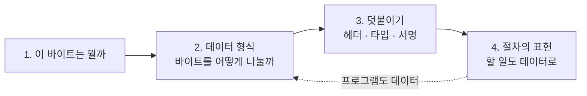

그럼 컴퓨터는 어떻게 어떤 바이트가 "프로그램"인지 알까? 가장 극단적인 데이터, 실행 파일부터 보자.

---

## 2. 데이터 형식

### 2.1 모든 것은 데이터: 프로그램이 실행되기까지

**실행 파일도 헤더가 붙은 데이터일 뿐이다. 커널은 그 헤더를 읽고, 메모리에 올리고, entry point로 점프한다.**

`./a.out`을 치면 그 뒤에 무슨 일이 일어날까? 셸이 하는 일은 딱 하나, 커널에게 "이 파일 실행해 줘"라고 부탁하는 것(`execve`)이다. 커널은 파일의 **앞 몇 바이트**를 읽어 형식을 판단한다.

리눅스 실행 파일 형식은 **ELF**다. 헤더 맨 앞 4바이트는 magic number `7F 45 4C 46`이고, `45 4C 46`은 ASCII로 `E L F`다. 64비트 ELF 헤더는 64바이트이고, 주요 필드는 아래와 같다.

| 오프셋 | 크기 | 필드 | 뜻 |
|---|---|---|---|
| 0 | 4 | magic | `7F 45 4C 46` |
| 4 | 1 | class | 1이면 32비트, 2면 64비트 |
| 5 | 1 | data | 1이면 little-endian, 2면 big-endian |
| 7 | 1 | OS/ABI | 보통 0 (System V) |
| 16 | 2 | type | 2면 실행 파일, 3이면 공유 라이브러리 |
| 18 | 2 | machine | 0x3E면 x86-64, 0xB7이면 AArch64 |
| 24 | 8 | entry | 실행을 시작할 가상 주소 |
| 32 | 8 | phoff | 프로그램 헤더 테이블 위치 |
| 56 | 2 | phnum | 프로그램 헤더 개수 |

프로그램 헤더는 "파일의 어느 구간을 메모리 어디에 어떤 권한으로 올려라"는 목록이다. 커널은 이 목록대로 `mmap`한다. 동적 링크 실행 파일이면 `PT_INTERP` 항목에 로더(`/lib64/ld-linux-x86-64.so.2`) 경로가 적혀 있다. 커널은 로더를 먼저 올리고, 로더가 공유 라이브러리를 붙인 뒤 entry로 점프한다.

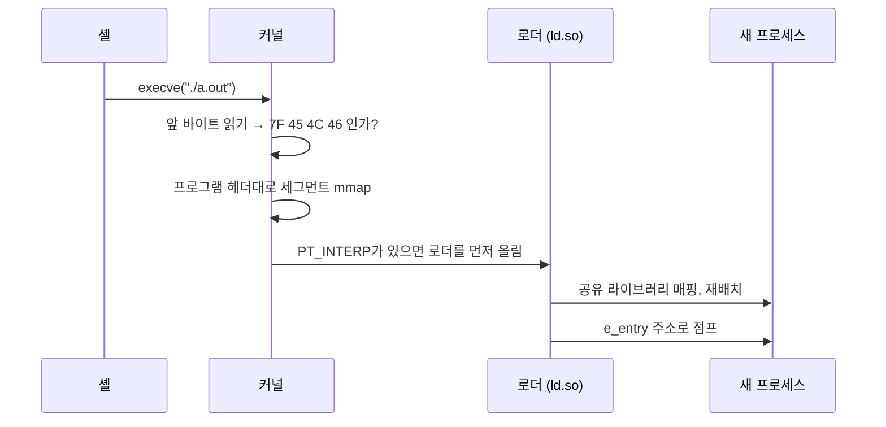

헤더는 **로더에게 보내는 설명서**다. 커널이 하는 일을 흉내 내 보자. 먼저 앞 4바이트로 ELF인지 확인한다.

```jsx live noInline showLineNumbers
const head = new Uint8Array([0x7f, 0x45, 0x4c, 0x46]); // 파일의 맨 앞 4바이트

function Test_ELF는_앞_4바이트로_자기를_알린다() {
  const isElf = head[0] === 0x7f && new TextDecoder().decode(head.slice(1)) === "ELF";
  return isElf ? "7F 'E' 'L' 'F' — ELF 다. 헤더를 읽자" : "ELF 가 아니다. 실행하지 않는다";
}

render(Test_ELF는_앞_4바이트로_자기를_알린다);
```

ELF라면 오프셋 24부터 8바이트가 entry point다.

```jsx live noInline showLineNumbers
const header = new Uint8Array(64);
header.set([0x00, 0x10, 0x40], 24); // 오프셋 24: entry (little-endian 으로 0x401000)

function Test_헤더만_읽으면_어디로_점프할지_안다() {
  const entry = new DataView(header.buffer).getBigUint64(24, true);
  return `entry = 0x${entry.toString(16)} ← 여기로 점프한다`;
}

render(Test_헤더만_읽으면_어디로_점프할지_안다);
```

:::note Wine — 다른 OS의 실행 파일을 돌리기
윈도우 `.exe`는 **PE** 형식이다. 리눅스 커널은 PE를 모르니 `./game.exe`는 그냥 실행되지 않는다. 그런데 Wine을 깔면 돌아간다. 무슨 일이 일어난 걸까?

실행 파일이 돌아가려면 **세 층**이 맞아야 한다. Wine이 이 중 어디를 건드리는지 보면 "형식"이 무엇인지 분명해진다.

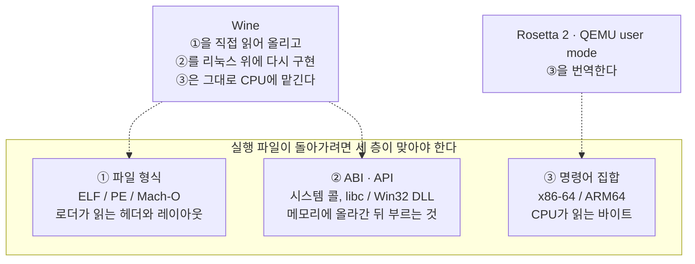

- **① 형식:** Wine은 자기 로더로 PE 헤더를 읽는다. PE는 `MZ`로 시작하고, 그 안의 오프셋이 가리키는 곳에 `PE\0\0` magic이 또 있다. 커널 대신 사용자 공간 프로그램이 로더 역할을 할 뿐, 하는 일은 위의 ELF 로딩과 같다. 헤더를 읽고, 섹션을 메모리에 올리고, entry point로 점프한다.
- **② ABI·API:** 올라간 코드는 `CreateFileW`, `MessageBoxA` 같은 Win32 함수를 부른다. Wine은 이 DLL들을 리눅스 시스템 콜 위에 다시 구현해서 같은 이름으로 제공한다. Wine 작업량의 대부분이 여기다.
- **③ 명령어 집합:** x86-64 윈도우 프로그램을 x86-64 리눅스에서 돌리면 기계어는 같다. 그래서 Wine은 CPU를 흉내 내지 않는다. 이름부터가 **"Wine Is Not an Emulator"** 다. 반대로 Apple Silicon에서 인텔 맥 앱을 돌리는 Rosetta 2는 ①②는 그대로 두고 ③만 번역한다.

리눅스에는 **binfmt_misc**라는 기능도 있다. "이 magic으로 시작하는 파일은 이 프로그램으로 실행하라"를 등록한다. `MZ`를 Wine에 연결해 두면 `./game.exe`가 그대로 돌아간다. 스크립트 첫 줄의 `#!`(셔뱅)을 보고 인터프리터를 고르는 것과 정확히 같은 메커니즘이고, 커널이 확장자가 아니라 **앞 바이트**를 본다는 증거다.

덤으로, `.exe`를 hexdump하면 앞부분에 `This program cannot be run in DOS mode.`라는 문자열이 보인다. PE 파일 머리에 들어 있는 **진짜 DOS 프로그램**이다. DOS에서 실행하면 이 메시지를 찍고 끝나도록 만든 작은 프로그램이 헤더 자리에 들어 있다. 헤더 안에 프로그램이 들어 있는 셈이다.
:::

Wine에서 남길 것은 Wine 자체가 아니라 세 층 그림이다. **"형식"은 ① 한 층일 뿐이다.**

**생각할 문제**

- Mac 바이너리(Mach-O)는 왜 리눅스에서 실행되지 않을까? 형식이 달라서일까, 시스템 콜과 라이브러리(ABI)가 달라서일까?

- Mach-O fat binary의 magic은 `CA FE BA BE`다. Java class 파일의 magic도 `CA FE BA BE`다. 둘이 같은 파일을 받으면 어떻게 구분할까?

- 반대 방향도 가능할까? 리눅스 ELF를 윈도우에서 돌리려면 무엇이 필요할까?

실행 파일은 디스크에서 메모리로 **"올라가는"** 데이터였다. 반대로, 메모리에 있는 것을 밖으로 **"내보내야"** 할 때는?

### 2.2 직렬화와 역직렬화

**내 주소 공간을 벗어나는 순간 객체는 bytes가 되어야 한다. 그 변환은 CPU·메모리·크기 비용을 낸다. 프로세스 분리의 가장 큰 약점이 바로 이 비용이다.**

변수 하나에 객체가 있다. 이걸 옆 프로세스에 주고 싶다. 포인터 값을 그대로 보내면 될까?

#### 왜 필요한가

메모리 안의 객체는 **포인터**로 서로를 가리킨다. 포인터는 "내 주소 공간 안의 몇 번지"라는 숫자다. 다른 프로세스에 `0x7ffe3a2b…`라는 숫자를 보내면, 그쪽 주소 공간의 그 번지에는 전혀 다른 것이 있거나 아무것도 없다.

그래서 내 메모리 공간을 벗어나는 모든 경계(파일, 네트워크, 다른 프로세스)에서는 객체를 **포인터가 없는 평평한 바이트 나열**로 바꿔야 한다. 이것이 **직렬화(serialization)** 다. 받는 쪽은 그 바이트로 객체를 다시 만든다. 이것이 **역직렬화(deserialization)** 다.

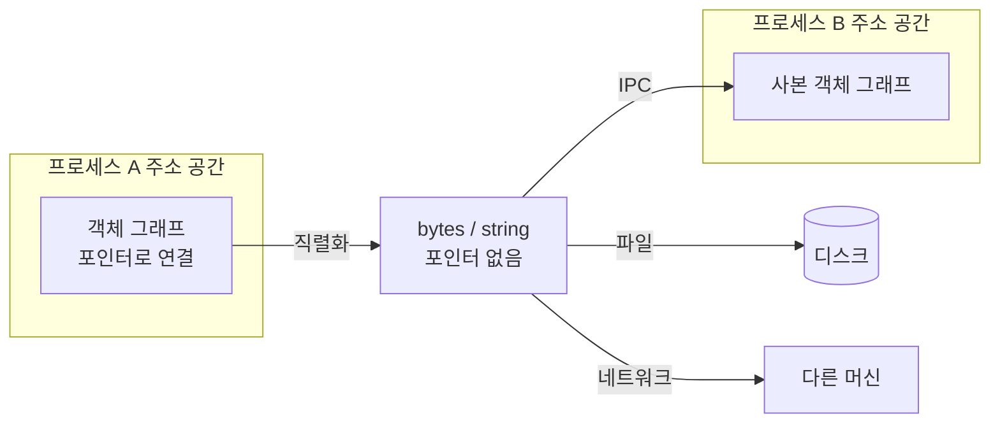

#### 직렬화하면서 사라지는 것들

- **타입:** JSON에는 정수와 실수의 구분이 없고, 날짜 타입도 없다. `Date`는 문자열이 된다.
- **참조 관계:** 같은 객체를 두 곳에서 가리키던 것이 두 개의 사본이 된다. 순환 참조는 아예 직렬화할 수 없다.
- **함수:** 코드와 클로저는 바이트로 바꿀 "일반적인" 방법이 없다.
- **락, 소켓 등:** 프로세스 안에서만 의미가 있는 일시적 상태. 락이나 파일 디스크립터 번호를 다른 프로세스로 옮기면 아무 뜻이 없다.

`JSON.stringify`로 텍스트로 바꿨다가 되돌려 보자. 무엇이 살아남을까?

```jsx live noInline showLineNumbers
const original = { at: new Date(0) };

function Test_JSON을_거치면_Date는_문자열이_된다() {
  const back = JSON.parse(JSON.stringify(original));
  return `${typeof back.at}: ${back.at}`;
}

render(Test_JSON을_거치면_Date는_문자열이_된다);
```

```jsx live noInline showLineNumbers
const original = new Map([["a", 1]]);

function Test_JSON을_거치면_Map은_빈_객체가_된다() {
  return JSON.stringify(original);
}

render(Test_JSON을_거치면_Map은_빈_객체가_된다);
```

```jsx live noInline showLineNumbers
const me = { name: "me" };
me.self = me; // 자기 자신을 가리킨다

function Test_JSON은_순환_참조를_직렬화하지_못한다() {
  try {
    return JSON.stringify(me);
  } catch (e) {
    return `${e.name}: 끝없이 따라가야 해서 멈췄다`;
  }
}

render(Test_JSON은_순환_참조를_직렬화하지_못한다);
```

```jsx live noInline showLineNumbers
const original = { name: "add", fn: (a, b) => a + b };

function Test_JSON을_거치면_함수는_사라진다() {
  return JSON.stringify(original);
}

render(Test_JSON을_거치면_함수는_사라진다);
```

브라우저가 Worker 사이에서 쓰는 직렬화 `structuredClone`은 더 많이 살린다.

```jsx live noInline showLineNumbers
const original = { at: new Date(0), m: new Map([["a", 1]]) };

function Test_structuredClone은_Date와_Map을_살린다() {
  const copy = structuredClone(original);
  return `Date 인가? ${copy.at instanceof Date} / Map 인가? ${copy.m instanceof Map}`;
}

render(Test_structuredClone은_Date와_Map을_살린다);
```

```jsx live noInline showLineNumbers
const original = { fn: () => 1 };

function Test_structuredClone도_함수는_넘기지_못한다() {
  try {
    structuredClone(original);
    return "넘어갔다";
  } catch (e) {
    return `${e.name}`;
  }
}

render(Test_structuredClone도_함수는_넘기지_못한다);
```

`structuredClone`이 더 많은 것을 살려 내지만 함수 앞에서는 둘 다 멈춘다. 형식이 무엇을 **표현할 수 있느냐**가 곧 무엇이 살아남느냐다.

#### 직렬화 오버헤드

직렬화하면 객체는 **항상** string이나 bytes가 된다. 그 과정은 공짜가 아니다.

| 비용 | 내용 | 예 |
|---|---|---|
| CPU | 객체 그래프를 순회하며 인코딩하고, 받는 쪽은 파싱해서 다시 만든다 | `3.14159`를 텍스트로 썼다가 다시 숫자로 되돌리는 것도 연산이다 |
| 메모리 | 원본과 직렬화된 사본이 동시에 존재한다 | 최대 사용량이 2배를 넘기도 하고, 할당이 늘어 GC 압박이 커진다 |
| 크기 | 텍스트 형식은 숫자와 필드 이름을 매번 글자로 쓴다 | bytes를 텍스트 통로로 보내려면 base64로 33%가 더 붙는다 (2.5) |
| 공유 상실 | 받는 쪽이 가진 것은 사본이다 | 한쪽을 고쳐도 다른 쪽에는 반영되지 않는다 |

얼마나 드는지 재 보자. 같은 주소 공간 안이라면 넘기는 데 드는 것이 없다.

```jsx live noInline showLineNumbers
const data = Array.from({ length: 100_000 }, (_, i) => ({ id: i, name: `item-${i}` }));

function Test_같은_주소_공간에서는_참조만_넘긴다() {
  const received = data; // 스레드 모델: 포인터만 넘긴다
  return received === data ? "같은 객체를 본다 — 복사한 바이트 0" : "사본이다";
}

render(Test_같은_주소_공간에서는_참조만_넘긴다);
```

경계를 건너면 직렬화 → 복사 → 역직렬화를 거친다.

```jsx live noInline showLineNumbers
const data = Array.from({ length: 100_000 }, (_, i) => ({ id: i, name: `item-${i}` }));

function Test_경계를_건너면_직렬화_비용을_낸다() {
  const start = performance.now();
  const received = JSON.parse(JSON.stringify(data)); // 프로세스 모델
  const ms = (performance.now() - start).toFixed(1);
  return `${ms} ms 걸렸고, 받은 것은 ${received === data ? "같은 객체" : "사본"}이다`;
}

render(Test_경계를_건너면_직렬화_비용을_낸다);
```

#### 스레드 vs 프로세스

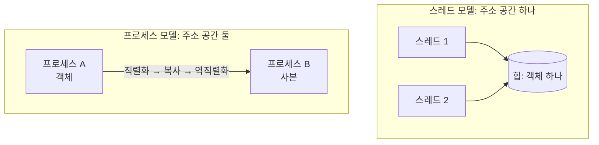

- **스레드**는 주소 공간을 공유한다. 참조만 넘기면 되고 직렬화가 필요 없다. 대신 두 스레드가 같은 객체를 동시에 건드릴 수 있어서 락과 경쟁 상태를 직접 관리해야 한다 (← 2장 "lock — 공유·상태의 냄새").
- **프로세스**는 주소 공간이 분리되어 있다. 데이터를 주고받을 때마다 직렬화 → 복사 → 역직렬화를 거친다. **프로세스를 쓸 때 가장 큰 약점이 바로 여기다.**

Python `multiprocessing.Pool`은 인자와 반환값을 pickle한다. 큰 DataFrame을 worker에 넘기면 계산보다 pickle에 시간이 더 걸려서, **병렬화했는데 오히려 느려지는** 일이 흔하다. sensible한가, smelly한가? 계산이 아니라 경계를 건너는 비용을 먼저 의심해야 한다.

그런데도 프로세스를 쓰는 이유가 있다.

- **격리:** 한쪽이 죽어도 다른 쪽은 산다. 메모리 오염이 번지지 않는다.
- **GIL 회피:** CPython에서는 스레드가 동시에 바이트코드를 실행하지 못한다. CPU 작업을 병렬로 돌리려면 프로세스가 필요했다. (free-threaded 빌드가 나오면서 바뀌고 있다.)
- **확장:** 경계가 이미 있으니 네트워크 너머 다른 머신으로 옮기기 쉽다. 프로세스 간 통신과 분산 시스템은 같은 문제를 푼다.

:::info 자주 나오는 질문 — "JSON 말고 빠른 형식을 쓰면 되지 않나요?"
형식을 바꾸면 비용이 줄기는 한다. 하지만 **변환 자체는 남는다.**
:::

**생각할 문제**

- `JSON.parse(JSON.stringify(x))`가 x와 같아지는 x의 조건은?

- Python `multiprocessing`으로 병렬화했더니 싱글 프로세스보다 느려졌다. 무엇부터 의심할까?

- 스레드는 직렬화가 필요 없는데 왜 굳이 프로세스를 쓸까? 반대로 스레드를 쓰면 무엇을 잃을까?

- Web Worker에 객체를 넘길 때 내부에서 무슨 일이 일어날까? (2.3-A의 transfer에서 다시 만난다.)

몇 가지 더 생각해 볼 것이 남았다.

- 이 오버헤드를 어떻게 줄일까?
- 함수 그 자체를 보내고 싶으면 어떻게 할까?

### 2.3 직렬화 심화: 비용을 줄이는 방법, 그리고 함수를 넘길 때 생기는 일

**직렬화 비용은 복사를 피하거나 역직렬화를 생략해서 줄인다. 함수까지 넘기려 들면 받는 쪽이 코드를 실행하게 되는데, 이것이 원격 코드 실행(RCE)의 뿌리다. 근본 대책은 코드를 표현할 수 없는 형식을 고르는 것이다.**

#### A. 비용을 줄이는 방법

비용을 줄이는 가장 확실한 방법은 **변환을 안 하는 것**이다. 안 하고도 보낼 수 있는 경우가 네 가지 있다.

| 방법 | 원리 | 예 | 제약 |
|---|---|---|---|
| 소유권 이전 (transfer) | 복사하지 않고 버퍼의 주인을 넘긴다 | `postMessage(buf, [buf])` | 보낸 쪽은 그 버퍼를 더 쓸 수 없다 |
| 공유 메모리 | 두 프로세스가 같은 물리 메모리를 본다 | `SharedArrayBuffer`, Python `multiprocessing.shared_memory` | 포인터 없는 평평한 바이트만 올릴 수 있다 |
| fork로 미리 올려두기 | 부모가 올린 데이터를 자식이 copy-on-write로 본다 | Python `fork` 시작 방식에서 전역 변수 | 자식이 쓰기를 시작하면 복사된다 |
| 역직렬화 생략 형식 | 바이트를 객체로 다시 만들지 않고 그대로 읽는다 | flatbuffers, Arrow, numpy | 형식이 메모리 레이아웃을 그대로 정해야 한다 (2.6) |

공유 메모리 위에 numpy·Arrow 같은 **연속 메모리 형식**이 올라가는 이유가 여기 있다. **포인터가 없어야 공유할 수 있다.**

transfer는 이렇게 생겼다. 보낸 뒤 보낸 쪽 버퍼의 길이가 0이 된다.

```js
// main.js
const buf = new Float64Array(1_000_000).buffer; // 8 MB
worker.postMessage(buf, [buf]);   // 두 번째 인자: "이 버퍼는 복사 말고 넘겨라"
console.log(buf.byteLength);      // 0 — 주인이 바뀌었다. 더 이상 내 것이 아니다
```

이걸 브라우저 콘솔에서 돌려 보면, 객체 100만 개짜리 배열을 그냥 `postMessage`하면(structured clone으로 복사) 수백 ms가 걸리는 반면, 같은 숫자를 `Float64Array`에 담아 transfer하면 1ms 안팎으로 끝난다. 복사를 안 했기 때문이다. (`SharedArrayBuffer`는 cross-origin isolation 헤더 — COOP/COEP — 가 있어야 동작한다.)

:::info 자주 나오는 질문 — "transfer하면 왜 보낸 쪽이 못 쓰나요?"
주인이 하나여야 동시 접근 문제가 생기지 않는다. 2.2에서 말한 스레드의 락 문제를 처음부터 만들지 않으려는 설계다. 2장에서 본 **오너십은 하나인가**가 여기서도 그대로 적용된다.
:::

#### B. 함수를 넘기기

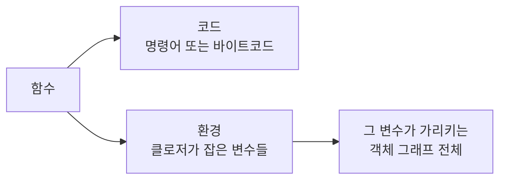

함수는 **코드와 환경의 합**이다. 코드만 보내면 환경이 없어서 돌아가지 않고, 환경까지 보내면 그 변수가 가리키는 객체 그래프가 통째로 딸려 간다.

함수를 넘기는 방법은 네 가지다.

| 무엇을 보내나 | 예 | 받는 쪽 조건 | 위험도 |
|---|---|---|---|
| **이름** | RPC(4.3), 작업 큐의 task 이름. Python pickle도 함수 자체가 아니라 `모듈.이름`만 저장한다 | 같은 코드가 이미 배포되어 있어야 한다 | 낮음. 허용 목록으로 통제할 수 있다 |
| **소스 코드** | `fn.toString()`을 보내고 `new Function`이나 `eval`로 되살린다 | 클로저 변수는 따라가지 못한다 | 높음. 받은 문자열을 그대로 실행한다 |
| **바이트코드 + 환경** | cloudpickle (PySpark, Ray, Dask가 사용) | Python 버전과 라이브러리 버전이 맞아야 한다 | 높음. 역직렬화하는 순간 실행될 수 있다 |
| **제한된 표현(DSL)** | SQL(4.4), 계산 그래프(4.5), 바이트코드(4.6), JSONLogic | 인터프리터가 있어야 한다 | 표현력을 일부러 제한해서 안전하게 만든다 |

#### C. 원격 코드 실행(RCE)

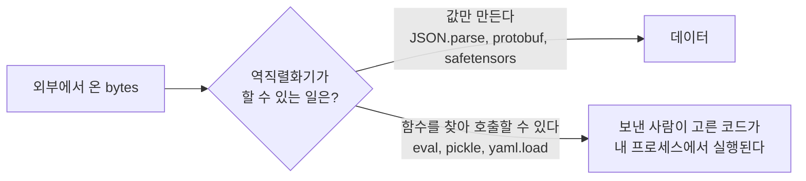

역직렬화기가 "값을 만드는 것"을 넘어 **"함수를 찾아 호출하는 것"** 까지 할 수 있으면, 데이터를 보낸 사람이 내 쪽에서 코드를 실행할 수 있다. 형식이 표현할 수 있는 것이 많을수록 위험도 같이 커진다. **데이터 형식 선택이 곧 보안 결정이다.**

**eval.** 옛날에는 JSON을 `eval('(' + text + ')')`로 파싱했다. JSON은 JavaScript 객체 리터럴과 모양이 같아서 편했다. 그런데 `text` 안에 함수 호출이 섞여 있으면 그것도 그대로 실행된다. `JSON.parse`가 따로 생긴 이유가 이것이다. `JSON.parse`는 문법이 좁아서 **값만 만들 수 있고 아무것도 호출하지 않는다.** sensible한가, smelly한가? 같은 입력을 둘에게 줘 보자.

```jsx live noInline showLineNumbers
const text = '{"a": log("실행됨")}'; // 값 자리에 함수 호출이 섞인 입력

function Test_JSON_parse는_데이터_속_함수_호출을_거절한다() {
  try {
    return JSON.stringify(JSON.parse(text));
  } catch (e) {
    return `${e.name} — 값이 아닌 것은 만들지 않는다`;
  }
}

render(Test_JSON_parse는_데이터_속_함수_호출을_거절한다);
```

```jsx live noInline showLineNumbers
const text = '{"a": log("실행됨")}'; // 같은 입력
const called = [];
const log = (msg) => { called.push(msg); return 1; }; // 입력이 부를 수 있는 함수

function Test_eval은_데이터_속_함수_호출을_실행한다() {
  const value = eval("(" + text + ")"); // 옛날 방식의 JSON 파싱
  return `결과: ${JSON.stringify(value)} / 실행된 호출: ${called}`;
}

render(Test_eval은_데이터_속_함수_호출을_실행한다);
```

`JSON.parse`는 문법 에러로 멈추고, `eval`은 **데이터 안의 함수 호출을 실행한다.** 정상 입력 `{"a": 1}`에서는 둘이 똑같기 때문에, 이 차이는 입력이 이상할 때만 드러난다.

**Python pickle.** pickle은 데이터 형식이라기보다 **작은 기계**다. 바이트 열을 명령어로 읽으며 스택에 값을 쌓고 객체를 조립한다. 명령어 중에는 **"이름으로 아무 모듈의 아무 함수를 가져와라"** 와 **"스택 위의 함수를 인자와 함께 호출하라"** 가 있다. 사용자 정의 클래스를 복원하려면 꼭 필요한 기능이다.

평범한 클래스 인스턴스를 `pickle.dumps`한 뒤 `pickletools.dis`로 찍어 보면 그 명령어가 보인다.

```text
>>> pickletools.dis(pickle.dumps(Point(1, 2)))
    0: \x80 PROTO      4
   ...
   11: \x8c SHORT_BINUNICODE '__main__'
   21: \x8c SHORT_BINUNICODE 'Point'
   28: \x93 STACK_GLOBAL          ← "모듈.이름으로 함수(클래스)를 찾아라"
   29: )    EMPTY_TUPLE
   30: \x81 NEWOBJ                ← "찾은 것을 호출해서 객체를 만들어라"
   ...
```

`'__main__'`과 `'Point'` 자리에는 **어떤 이름이든 들어갈 수 있다.** 가져올 수 있는 함수에 제한이 없다. 그래서 악의적으로 만든 pickle은 `loads` 하는 순간 보낸 사람이 고른 함수를 내 프로세스에서 실행한다. Python 공식 문서 맨 위에도 경고가 있다: **"신뢰할 수 없는 출처의 데이터는 절대 unpickle하지 말라."**

알아야 할 것은 하나다.

> **pickle은 데이터 형식이 아니라 작은 프로그램이다.**

이 구조를 바로 아래에서 간략화해 직접 만들어 본다(toy pickle).

**toy pickle.** 명령어가 두 종류뿐인 아주 작은 기계를 만들어 보자. "값을 쌓아라(`PUSH`)"와 "이름으로 함수를 찾아 호출하라(`CALL`)". 먼저 정상 payload를 열어 본다.

```jsx live noInline showLineNumbers
const GLOBALS = { makePoint: (x, y) => ({ x, y }) };

function loads(payload) {
  const stack = [];
  for (const [op, arg] of payload) {
    if (op === "PUSH") stack.push(arg);
    if (op === "CALL") stack.push(GLOBALS[arg](...stack.splice(0))); // 이름으로 찾아서, 쌓인 값으로 호출
  }
  return stack.pop();
}

function Test_toy_pickle은_명령어를_실행해서_객체를_만든다() {
  return JSON.stringify(loads([["PUSH", 1], ["PUSH", 2], ["CALL", "makePoint"]]));
}

render(Test_toy_pickle은_명령어를_실행해서_객체를_만든다);
```

전역 테이블에 `changeBackground`(배경색을 바꾸는 무해한 함수)가 하나 더 있다고 하자. 같은 기계에 조작한 payload를 넣으면?

```jsx live noInline showLineNumbers
const page = { background: "white" };
const GLOBALS = {
  makePoint: (x, y) => ({ x, y }),
  changeBackground: (color) => { page.background = color; }, // 무해한 함수. 배경색만 바꾼다
};

function loads(payload) {
  const stack = [];
  for (const [op, arg] of payload) {
    if (op === "PUSH") stack.push(arg);
    if (op === "CALL") stack.push(GLOBALS[arg](...stack.splice(0))); // 이름으로 찾아서, 쌓인 값으로 호출
  }
  return stack.pop();
}

function Test_toy_pickle은_데이터를_열었을_뿐인데_화면을_바꾼다() {
  loads([["PUSH", "red"], ["CALL", "changeBackground"]]); // 조작한 payload
  return `배경색: ${page.background} — 데이터를 열었을 뿐인데 화면이 바뀌었다`;
}

render(Test_toy_pickle은_데이터를_열었을_뿐인데_화면을_바꾼다);
```

`CALL`이 꺼낼 수 있는 이름을 허용 목록으로 좁히면 어떨까? Python에서 `Unpickler.find_class`를 재정의하는 것과 같은 원리다.

```jsx live noInline showLineNumbers
const page = { background: "white" };
const GLOBALS = {
  makePoint: (x, y) => ({ x, y }),
  changeBackground: (color) => { page.background = color; }, // 무해한 함수. 배경색만 바꾼다
};
const ALLOWED = ["makePoint"]; // 꺼낼 수 있는 이름은 이것뿐
function loads(payload) {
  const stack = [];
  for (const [op, arg] of payload) {
    if (op === "PUSH") stack.push(arg);
    if (op === "CALL") {
      if (!ALLOWED.includes(arg)) throw new Error(`허용되지 않은 함수: ${arg}`);
      stack.push(GLOBALS[arg](...stack.splice(0)));
    }
  }
  return stack.pop();
}

function Test_허용_목록이면_조작한_payload가_막힌다() {
  try {
    loads([["PUSH", "red"], ["CALL", "changeBackground"]]);
  } catch (e) {
    return `${e.message} / 배경색: ${page.background}`;
  }
}

render(Test_허용_목록이면_조작한_payload가_막힌다);
```

**데이터를 열었을 뿐인데 화면이 바뀐다.** 허용 목록으로 좁히자 조작한 payload는 에러로 끝난다. 명령어 집합이 무엇을 할 수 있는지가 형식의 안전성을 정한다.

**ML 쪽에서 특히 조심할 곳.** 모델 파일을 주고받는 일이 잦은 곳이라 이 문제가 자주 터진다.

| 라이브러리 | 상황 | 바뀐 것 |
|---|---|---|
| `torch.load` | pickle 기반. 남이 올린 체크포인트를 열면 코드가 실행될 수 있다 | PyTorch 2.6부터 `weights_only=True`가 기본 |
| safetensors | 그래서 나온 형식. 8바이트 헤더 길이 + JSON 헤더 + 텐서 raw bytes. **코드를 표현할 방법이 아예 없다** | Hugging Face 기본 형식 |
| `joblib` / `pickle`로 저장한 scikit-learn 모델 | 위험성이 같다 | 출처를 통제하거나 ONNX 같은 형식으로 변환 |
| `numpy.load` | 객체 배열은 pickle을 쓴다 | 1.16.3부터 `allow_pickle=False`가 기본 |

다른 사례도 이름과 교훈만 짚고 가자.

- **PyYAML `yaml.load`:** YAML에는 임의의 Python 객체를 만드는 태그가 있다. 그래서 `safe_load`가 따로 있고, 최근 버전은 `load`에 Loader를 명시하도록 바꿨다.
- **Java 역직렬화(2015, Apache Commons Collections):** 클래스패스에 있는 **정상 클래스들을 엮어서** 코드를 실행했다. "표준 라이브러리만 있어도 위험할 수 있다"는 교훈.
- **Log4Shell(2021):** 역직렬화는 아니지만 같은 계열이다. 로그 문자열 안의 특정 패턴을 라이브러리가 "해석해서 실행"했다. **데이터가 코드로 해석되었다**는 점이 같다.

정리하면 이렇다.

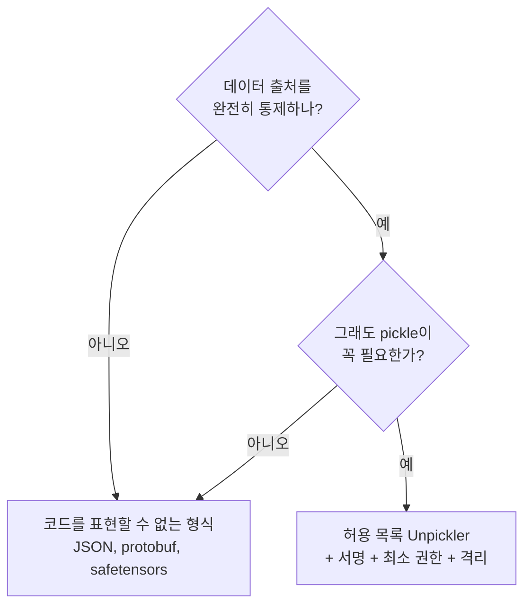

:::info 자주 나오는 질문 — "그럼 pickle을 쓰면 안 되나요?"
자기 코드가 만든 것을 자기 코드가 읽는 것은 괜찮다. 출처를 통제할 수 없게 되는 순간 형식을 바꾼다. `torch.load(..., weights_only=True)`는 텐서만 복원하는 제한 모드라 훨씬 안전하다. 가장 안전한 것은 코드를 표현할 방법이 아예 없는 safetensors다.
:::

**생각할 문제**

- 공유 드라이브에 누가 올려 둔 `model.pt`를 열어도 될까? 열기 전에 무엇을 확인할까?

- pickle을 꼭 써야 한다면, 그래도 안전하게 쓸 수 있을까?

- JSON은 정말 안전할까? 코드 실행은 없지만 다른 위험이 있을까?

지금까지는 바이트를 어떻게 **"옮기나"** 였다. 이제 바이트를 어떻게 **"끊어 읽나"** 로 간다. 가장 익숙한 데이터, 글자부터.

### 2.4 세상의 모든 문자를 표현하려면 몇 비트가 필요할까?

**세상의 모든 문자에 번호를 붙이면 21비트면 충분하다. 그런데 실제로는 그 번호를 그대로 저장하지 않고, 글자마다 길이를 바꿔 가며 저장한다. 그리고 "글자 하나"가 무엇인지조차 보는 곳마다 다르다.**

세상의 모든 문자에 번호를 붙인다고 해 보자. 영어 알파벳, 한글 11,172자, 수만 자의 한자, 각 나라의 문자, 수학 기호, 그리고 이모지까지. 몇 비트면 될까? 8비트(256개)는 영어에나 충분하다. 16비트(65,536개)면 될까? 32비트는 있어야 할까?

답은 그 사이, **21비트**다. 모든 문자에 번호표를 붙이는 약속이 **유니코드**이고, 번호 하나를 **코드 포인트**라고 부른다. `U+AC00`처럼 쓰는데, 이건 "가"다. 번호는 0부터 약 111만(`0x10FFFF`)까지 있다. 2^20(약 105만)으로는 조금 모자라고, 2^21(약 210만)이면 넉넉하다.

그런데 번호를 21비트 그대로 저장하는 곳은 거의 없다. 번호를 바이트로 바꾸는 방법(**인코딩**)이 따로 있다.

- **UTF-32:** 모든 글자를 4바이트에 담는다. 단순하지만, 1바이트면 되는 영어 글자도 4바이트를 쓴다.
- **UTF-16:** 대부분의 글자는 2바이트, 이모지처럼 번호가 큰 글자는 2바이트 두 개(**surrogate pair**)로 쓴다. Java, JavaScript, Windows가 메모리 안에서 쓰는 방식이다.
- **UTF-8:** 글자에 따라 1\~4바이트. 영어(ASCII)는 옛날 그대로 1바이트라서 오래된 시스템과도 잘 맞는다. 웹 페이지의 98% 이상이 UTF-8이다.

UTF-8은 번호의 크기에 따라 바이트 수를 바꾼다.

| 코드 포인트 범위 | UTF-8 바이트 패턴 | 실을 수 있는 비트 |
|---|---|---|
| U+0000 \~ U+007F | `0xxxxxxx` | 7 |
| U+0080 \~ U+07FF | `110xxxxx 10xxxxxx` | 11 |
| U+0800 \~ U+FFFF | `1110xxxx 10xxxxxx 10xxxxxx` | 16 |
| U+10000 \~ U+10FFFF | `11110xxx 10xxxxxx 10xxxxxx 10xxxxxx` | 21 |

UTF-8의 영리한 점이 하나 있다. **이어지는 바이트는 항상 `10`으로 시작한다.** 그래서 바이트 나열 중간 아무 데서나 읽기 시작해도 글자 경계를 바로 찾을 수 있다(self-synchronizing). 2.1의 magic number처럼 **바이트 자신이 자기 역할을 알려주는** 설계다. 약속이 바깥이 아니라 바이트 안에 적혀 있다.

#### "문자"란 무엇인가

층마다 다르다.

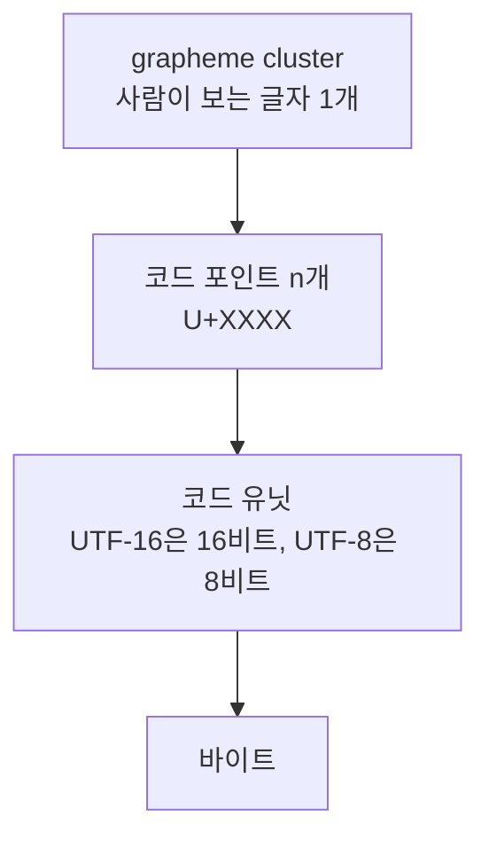

직접 세어 보자. 먼저 가장 흔한 착각부터.

```jsx live showLineNumbers
function Test_length는_글자_수가_아니다() {
  return `"😀".length = ${"😀".length}`; // UTF-16 코드 유닛 수를 센다
}
```

```jsx live noInline showLineNumbers
const family = "👨‍👩‍👧"; // 사람 눈에는 한 글자

function Test_문자_하나의_크기는_층마다_다르다() {
  const bytes = new TextEncoder().encode(family).length;
  const codePoints = [...family].length;
  const graphemes = [...new Intl.Segmenter("ko", { granularity: "grapheme" }).segment(family)].length;
  return `${bytes}바이트 / ${family.length} 코드 유닛 / ${codePoints} 코드 포인트 / ${graphemes} 글자`;
}

render(Test_문자_하나의_크기는_층마다_다르다);
```

```jsx live noInline showLineNumbers
const composed = "é";    // é 한 글자 (완성형)
const decomposed = "é"; // e + 악센트 (조합형)
const size = (s) => new TextEncoder().encode(s).length;

function Test_같아_보이는_é도_바이트가_다르다() {
  return `${size(composed)}바이트 vs ${size(decomposed)}바이트, 같은가? ${composed === decomposed}`;
}

render(Test_같아_보이는_é도_바이트가_다르다);
```

```jsx live noInline showLineNumbers
const composed = "é";    // é 한 글자 (완성형)
const decomposed = "é"; // e + 악센트 (조합형)

function Test_정규화하면_같아진다() {
  return `NFC 로 맞춘 뒤 같은가? ${composed.normalize("NFC") === decomposed.normalize("NFC")}`;
}

render(Test_정규화하면_같아진다);
```

`é` 두 개가 포인트다. 화면에는 같은 글자인데 바이트가 다르다. 그래서 비교하기 전에 **정규화(NFC/NFD)** 가 필요하다. 사용자 이름이 "같은데 다르다"고 나오는 버그가 대부분 여기서 온다. (macOS 파일 시스템은 한글 파일명을 NFD로 저장해서, 다른 OS로 옮기면 자모가 풀려 보이는 일이 있다. 같은 문제다.)

:::info 자주 나오는 질문 — "한글은 왜 3바이트인가요?"
한글 음절(U+AC00\~U+D7A3)이 UTF-8의 3바이트 구간(U+0800\~U+FFFF)에 있어서다. 그래서 한글 위주의 텍스트는 오히려 UTF-16(글자당 2바이트)이 더 작다. 메모리 안의 문자열 형식은 언어마다 다르고(JS·Java는 UTF-16), **경계를 건널 때 UTF-8로 바꾸는 것**이 보통이다.
:::

**생각할 문제**

- 상한이 왜 하필 0x10FFFF일까?

- 이모지 하나를 반으로 자르면 어떻게 될까? 문자열 앞 N글자를 잘라 미리보기를 만들 때 무엇을 기준으로 잘라야 할까?

글자를 바이트로 바꿨으니, 반대로 바이트를 글자로 바꿔야 하는 상황도 있겠다.

### 2.5 랜덤한 바이트를 문자열로: base64

**텍스트만 다니는 통로로 아무 바이트나 보내려면, 6비트씩 끊어 64개 글자에 대응시킨다. 크기는 33% 늘어난다.**

암호 키 16바이트를 JSON에 넣어야 한다. 그냥 문자열로 바꾸면 어떻게 될까?

텍스트만 다니는 통로는 생각보다 많다. JSON 문자열 값, URL, HTTP 헤더, 이메일 본문(MIME), 환경변수, 로그. 그런데 랜덤 바이트는 대부분 올바른 UTF-8이 아니라서 그냥 문자열로 바꾸면 깨진다(2.4). 그래서 **어떤 바이트가 와도 깨지지 않는 글자**만 쓰는 변환이 필요하다.


먼저 깨지는 것부터 보자.

```jsx live noInline showLineNumbers
const key = new Uint8Array([0xff, 0x00, 0x80, 0x41]); // 암호 키의 일부라고 하자

function Test_랜덤_바이트를_그냥_문자열로_바꾸면_깨진다() {
  const asText = new TextDecoder().decode(key);  // 그냥 문자열로
  const back = new TextEncoder().encode(asText); // 다시 바이트로
  return `${key.length}바이트 → ${JSON.stringify(asText)} → ${back.length}바이트 (원본을 잃었다)`;
}

render(Test_랜덤_바이트를_그냥_문자열로_바꾸면_깨진다);
```

```jsx live noInline showLineNumbers
const key = new Uint8Array([0xff, 0x00, 0x80, 0x41]); // 암호 키의 일부라고 하자

function Test_base64는_어떤_바이트든_그대로_되돌린다() {
  const text = btoa(String.fromCharCode(...key)); // 64개의 안전한 글자로만
  const back = Uint8Array.from(atob(text), (c) => c.charCodeAt(0));
  return `${text} → [${[...back].map((b) => b.toString(16)).join(" ")}] (원본 그대로)`;
}

render(Test_base64는_어떤_바이트든_그대로_되돌린다);
```

`�`가 섞이고, 되돌리면 바이트 수부터 달라진다. base64는 언제나 원래 바이트로 정확히 돌아온다.

#### 원리

3바이트(24비트)를 6비트씩 4덩어리로 나누고, 각 덩어리(0\~63)를 `A-Z a-z 0-9 + /` 64개 글자 중 하나로 바꾼다. `Man`을 비트로 쪼개 보자.

```jsx live noInline showLineNumbers
const ALPHABET = "ABCDEFGHIJKLMNOPQRSTUVWXYZabcdefghijklmnopqrstuvwxyz0123456789+/";

function Test_Man은_6비트씩_끊으면_TWFu가_된다() {
  const bits = [..."Man"].map((c) => c.charCodeAt(0).toString(2).padStart(8, "0")).join(""); // 24비트
  const groups = bits.match(/.{6}/g); // 6비트씩 4덩어리
  return `${groups.join(" ")} → ${groups.map((g) => ALPHABET[parseInt(g, 2)]).join("")}`;
}

render(Test_Man은_6비트씩_끊으면_TWFu가_된다);
```

길이가 3의 배수가 아니면 어떻게 될까?

```jsx live showLineNumbers
function Test_3의_배수가_아니면_끝에_등호가_붙는다() {
  return ["Man", "Ma", "M"].map((s) => `${s} → ${btoa(s)}`).join(" / ");
}
```

1바이트 남으면 `==`, 2바이트 남으면 `=`를 붙여 4글자 단위를 맞춘다. 3바이트가 4글자가 되니 크기는 4/3, 즉 **33%** 늘어난다.

#### 변형과 친구들

| 인코딩 | 글자 수 | 크기 증가 | 쓰는 곳 | 특징 |
|---|---|---|---|---|
| hex | 16 | +100% | 해시 표기, 디버깅 | 사람이 읽기 가장 쉽다 |
| base32 | 32 | +60% | OTP 시크릿 | 대소문자 구분이 없어서 불러 주기 좋다 |
| base58 | 58 | +37% | 비트코인 주소 | 헷갈리는 `0 O I l`을 뺐다 |
| base64 | 64 | +33% | 거의 모든 곳 | 표준 |
| base64url | 64 | +33% | URL, JWT | `+/` 대신 `-_`, padding 생략 |
| base85 | 85 | +25% | PDF, git 바이너리 패치 | 4바이트 → 5글자 |

128비트 UUID 하나를 하이픈을 넣은 hex로 쓰면 36글자, base64url로 쓰면 22글자다 (2.8과 연결).

:::info 자주 나오는 질문 — "`=`는 왜 붙이나요? 없어도 길이로 알 수 있잖아요."
맞다. 그래서 base64url은 보통 뺀다. 원래 규격이 4글자 단위 정렬을 원했을 뿐이다.
:::

**생각할 문제**

- 왜 하필 64일까? 출력 가능한 ASCII는 95개인데 더 쓰면 안 될까?

- 이미지를 base64 data URI로 HTML에 넣으면 무엇이 좋아지고 무엇이 나빠질까?

지금까지는 **정확히** 옮기는 이야기였다. 이제 **작게** 옮기려면 무엇을 버려야 하는지 보자.

### 2.6 필요한 정보만 남기기 vs redundancy

**압축하기, 빨리 읽기, 스키마 유연성은 트레이드오프 관계에 있다. 형식마다 어디에 서 있는지가 다르다.**

모니터링 그래프의 점 하나는 타임스탬프 8바이트, 값 8바이트, 합쳐서 16바이트다. 이걸 평균 1.4바이트로 줄일 수 있다. 무엇을 버렸을까?

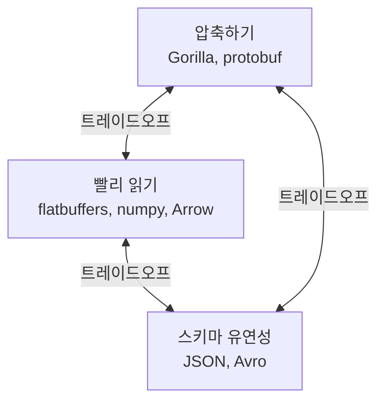

아래 세 형식을 보면서, 각각이 이 삼각형의 어느 꼭짓점에 가까운지 생각해 보자.

#### Gorilla — 시계열 압축

Facebook이 2015년에 발표한 인메모리 시계열 DB의 압축 방식이다. 모니터링 지표처럼 **"조금씩 변하는 값이 일정한 간격으로 들어오는"** 데이터를 노린다.

- **타임스탬프:** 간격이 거의 일정하니 **delta-of-delta**(간격의 변화량)를 저장한다. 대부분 0이라 1비트로 끝난다.
- **값:** 이전 값과 **XOR**한다. 비슷한 값끼리 XOR하면 앞뒤가 0으로 채워진 결과가 나온다. 가운데 "의미 있는 비트"만 저장한다.

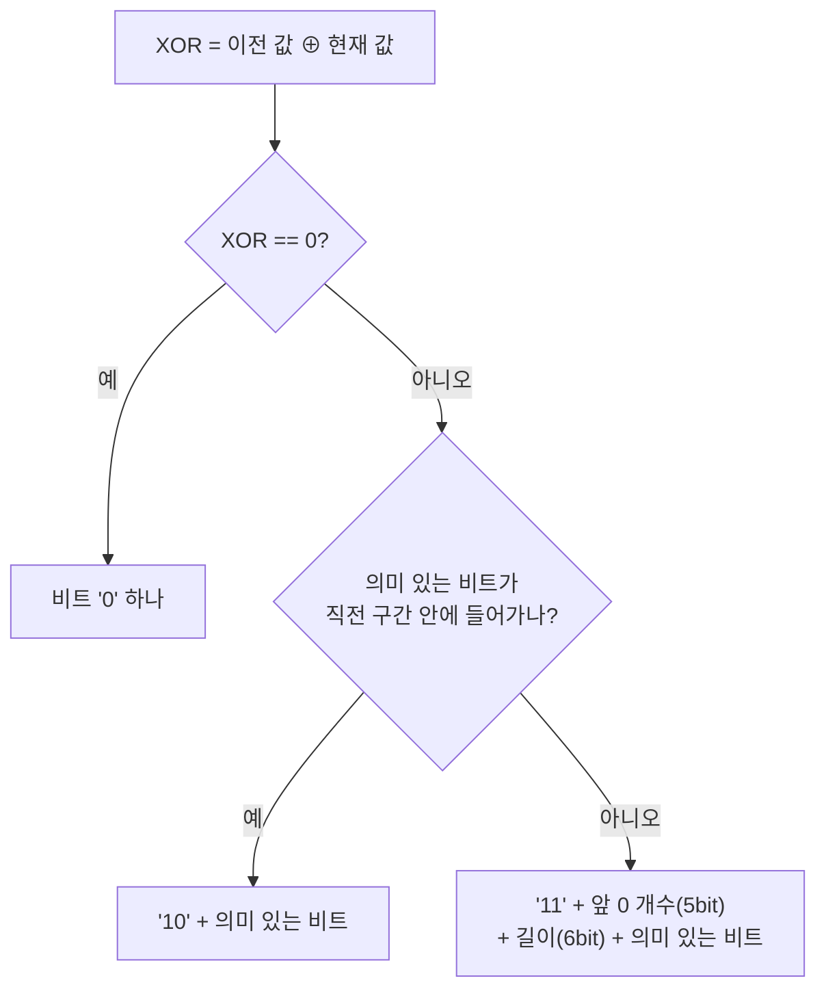

두 아이디어를 하나씩 확인해 보자. 먼저 타임스탬프.

```jsx live noInline showLineNumbers
const ts = [0, 60, 120, 180, 241, 300]; // 60초 간격, 한 번 1초 밀렸다

function Test_간격이_일정하면_delta_of_delta는_0이다() {
  const deltas = ts.slice(1).map((t, i) => t - ts[i]);       // 간격
  const dods = deltas.slice(1).map((d, i) => d - deltas[i]); // 간격의 변화량
  return `간격 [${deltas}] → 변화량 [${dods}]`;
}

render(Test_간격이_일정하면_delta_of_delta는_0이다);
```

값은 이전 값과 XOR한다.

```jsx live noInline showLineNumbers
// float64 의 64비트를 정수로 꺼낸다
function bits(x) {
  const view = new DataView(new ArrayBuffer(8));
  view.setFloat64(0, x);
  return view.getBigUint64(0);
}

function Test_같은_값이면_XOR는_0이라_1비트면_된다() {
  return (bits(12) ^ bits(12)) === BigInt(0) ? "XOR = 0 → 비트 '0' 하나만 쓴다" : "다르다";
}

render(Test_같은_값이면_XOR는_0이라_1비트면_된다);
```

```jsx live noInline showLineNumbers
// float64 의 64비트를 정수로 꺼낸다
function bits(x) {
  const view = new DataView(new ArrayBuffer(8));
  view.setFloat64(0, x);
  return view.getBigUint64(0);
}

function Test_비슷한_값끼리_XOR하면_앞뒤가_0이다() {
  const xor = (bits(12) ^ bits(12.5)).toString(2).padStart(64, "0");
  const meaningful = xor.replace(/^0+|0+$/g, ""); // 앞뒤 0을 걷어낸 가운데
  return `${xor} → 의미 있는 비트 ${meaningful.length}개만 저장`;
}

render(Test_비슷한_값끼리_XOR하면_앞뒤가_0이다);
```

64비트 값이 1비트, 혹은 몇 비트로 끝난다. 논문 기준으로 포인트당 16바이트가 **평균 1.37바이트**로 줄었다.

대신 치르는 것이 있다. **앞 값을 알아야 뒤 값을 풀 수 있다.** 중간의 값 하나만 꺼내 읽을 수 없다. 그래서 Gorilla는 데이터를 2시간 단위 블록으로 끊어 둔다. "압축하기" 꼭짓점을 얻고 "빨리 읽기"를 일부 내준 것이다.

:::info 자주 나오는 질문 — "gzip과 뭐가 다른가요?"
gzip은 범용 압축이다. 반복되는 바이트 패턴을 찾는다. Gorilla는 **데이터의 성질**(조금씩 변한다, 간격이 일정하다)을 아는 전용 압축이다. 데이터를 아는 쪽이 거의 항상 더 잘 줄인다.
:::

#### protobuf / flatbuffers

**protobuf**는 필드마다 `tag = (필드 번호 << 3) | wire type`을 **varint**로 쓰고 값을 붙인다. 필드 이름은 바이트에 없고 `.proto` 파일에만 있다.

varint는 7비트씩 끊고, 각 바이트의 맨 앞 비트로 "뒤에 더 있다"를 표시한다.

```jsx live noInline showLineNumbers
function varint(n) {
  const out = [];
  do {
    let byte = n & 0x7f;     // 아래 7비트
    n >>>= 7;
    if (n > 0) byte |= 0x80; // 맨 앞 비트 1 = "뒤에 더 있다"
    out.push(byte.toString(16).padStart(2, "0"));
  } while (n > 0);
  return out;
}

function Test_150은_varint로_2바이트다() {
  return varint(150).join(" ");
}

render(Test_150은_varint로_2바이트다);
```

이걸로 `{id: 150, name: "abc"}`를 인코딩하면 8바이트가 된다. JSON과 나란히 놓아 보자.

```jsx live noInline showLineNumbers
const protobuf = [
  0x08, 0x96, 0x01,             // 1번 필드(varint) = 150
  0x12, 0x03, 0x61, 0x62, 0x63, // 2번 필드(길이 3) = "abc"
];

function Test_protobuf에는_필드_이름이_없다() {
  const json = JSON.stringify({ id: 150, name: "abc" });
  return `protobuf ${protobuf.length}바이트 vs JSON ${json.length}바이트 ${json}`;
}

render(Test_protobuf에는_필드_이름이_없다);
```

8바이트 대 23바이트다. 필드 이름 `"id"`, `"name"`이 바이트에 아예 없다. protobuf는 작고, 스키마 진화도 쉽다(번호만 안 바꾸면 필드를 추가·삭제할 수 있다). 대신 읽으려면 처음부터 끝까지 **파싱**해야 한다.

**flatbuffers**는 vtable에 각 필드의 offset을 적어 두고, 읽을 때는 offset으로 바로 접근한다(zero-copy). 파싱 단계가 없어서 게임이나 모바일처럼 읽기가 잦고 지연에 민감한 곳에 쓴다. 대신 크기는 protobuf보다 크다. 2.3-A에서 말한 "역직렬화 생략 형식"이 이것이다.

#### numpy

`.npy` 파일은 `93 4E 55 4D 50 59`(`\x93NUMPY`) magic, 버전, 헤더 길이, 그리고 `{'descr': '<f4', 'fortran_order': False, 'shape': (3, 4)}` 같은 텍스트 헤더 뒤에 **raw 바이트가 그대로** 온다. 2.1의 ELF와 구조가 같다. magic, 헤더, 그리고 본문.

메모리 안에서 numpy는 dtype, shape, **strides**, 데이터 포인터로 배열을 표현한다. strides는 "다음 원소로 가려면 몇 바이트 건너뛰나"다.

- float32 `(3, 4)` C-order 배열의 strides는 `(16, 4)`다. 한 행을 건너려면 16바이트, 한 열을 건너려면 4바이트.
- transpose하면 shape `(4, 3)`, strides `(4, 16)`이 된다. **데이터는 한 바이트도 움직이지 않는다.**

직접 확인해 보자.

```jsx live noInline showLineNumbers
const buffer = new Float32Array([0, 1, 2, 3, 4, 5, 6, 7, 8, 9, 10, 11]); // 한 줄로 쭉
const at = (strides, i, j) => buffer[(i * strides[0] + j * strides[1]) / 4]; // 바이트 오프셋 → 원소
const a = [16, 4]; // shape (3, 4) 의 strides

function Test_transpose는_strides만_바꾼다() {
  const aT = [a[1], a[0]]; // transpose: 숫자 두 개만 바꿨다
  return `a[1][2] = ${at(a, 1, 2)}, a.T[2][1] = ${at(aT, 2, 1)}, buffer 는 그대로`;
}

render(Test_transpose는_strides만_바꾼다);
```

이것이 2.3-A에서 말한 **"공유 메모리 위에 올릴 수 있는 형식"** 이다. 포인터가 없고, 레이아웃이 헤더(shape, strides, dtype)에 다 적혀 있다. 그래서 다른 프로세스는 같은 바이트를 보면서 헤더만 받으면 된다.

**생각할 문제**

- protobuf에서 필드 번호를 재사용하면 어떤 일이 생길까?

- 압축률이 가장 좋은 형식이 항상 최선일까? 중간의 값 하나만 꺼내야 할 때는 어떨까?

- numpy 배열을 `tolist()`로 바꿔 JSON으로 보내면 크기가 얼마나 커질까? 100만 개 float32로 계산해 보자.

protobuf는 이름을 `.proto`에 두고 바이트에는 번호만 남겼다. 그 파일을 잃어버리면? 해석법을 데이터 **안에** 넣을지 **밖에** 둘지, 그 이야기로 넘어가자.

### 2.7 self-contained? 해석법을 들고 다닐까: BSON 사례

**데이터가 자기 해석법을 함께 들고 다니면 독립적이지만 크고, 바깥 스키마에 기대면 작지만 스키마 없이는 못 읽는다. BSON은 JSON에 타입과 길이를 더해 "들고 다니는" 쪽을 택한 형식이다.**

10년 뒤 하드디스크에서 파일 하나를 찾았다. `.proto` 파일은 없다. 읽을 수 있을까?

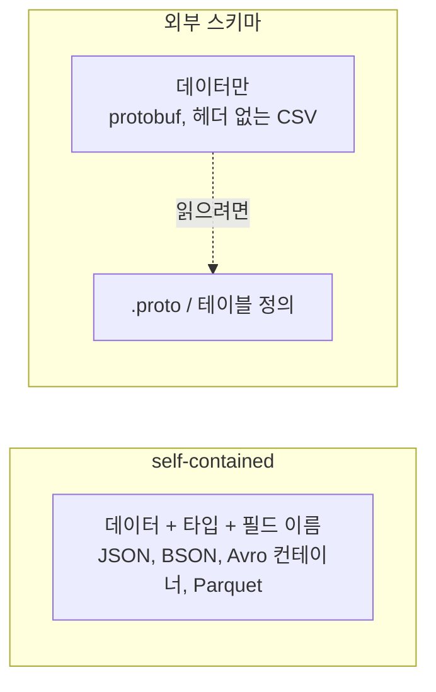

- **들고 다니는 쪽:** JSON(필드 이름이 들어 있다), BSON(타입까지), Avro 컨테이너 파일(스키마를 파일 앞에 붙인다), Parquet(footer에 스키마).
- **바깥에 기대는 쪽:** protobuf(번호만 있다), 헤더 없는 CSV, 고정 길이 레코드.
- **중간 형태:** Avro 메시지 하나에는 스키마가 없지만, 스키마 레지스트리의 ID를 붙여 보낸다. "스키마를 매번 보내지는 않지만 **어디 있는지는** 알려 준다." 3.2에서 다시 본다.

**비용은 크기, 이득은 독립성이다.** 10년 뒤에 `.proto` 파일을 잃어버리면 protobuf 바이트는 숫자 더미다.

#### 사례: MongoDB의 BSON

JSON에는 약점이 있다. 정수와 실수 구분이 없고, 날짜·바이너리 타입이 없고, 어디서 끝나는지 알려면 끝까지 읽어야 한다. BSON은 각 값 앞에 **타입 바이트**를 두고, 문서와 문자열 앞에 **길이**를 둔다.

`{a: 1, b: "hi"}`의 BSON은 22바이트다.

| 바이트 | 뜻 |
|---|---|
| `16 00 00 00` | 문서 전체 길이 22 |
| `10` `61 00` `01 00 00 00` | int32 타입, 키 `a`, 값 1 |
| `02` `62 00` `03 00 00 00` `68 69 00` | string 타입, 키 `b`, 길이 3, `hi\0` |
| `00` | 문서 끝 |

바이트를 그대로 적어 보자.

```jsx live noInline showLineNumbers
const bson = [
  0x16, 0x00, 0x00, 0x00,                                     // 문서 전체 길이 22
  0x10, 0x61, 0x00, 0x01, 0x00, 0x00, 0x00,                   // int32, 키 "a", 값 1
  0x02, 0x62, 0x00, 0x03, 0x00, 0x00, 0x00, 0x68, 0x69, 0x00, // string, 키 "b", 길이 3, "hi\0"
  0x00,                                                       // 문서 끝
];

function Test_BSON은_타입과_길이를_들고_다녀서_JSON보다_크다() {
  const json = JSON.stringify({ a: 1, b: "hi" });
  return `BSON ${bson.length}바이트 vs JSON ${json.length}바이트`;
}

render(Test_BSON은_타입과_길이를_들고_다녀서_JSON보다_크다);
```

**BSON이 더 크다.** 그런데 왜 쓸까?

- **타입이 살아남는다.** int32 / int64 / double / Date / ObjectId / Binary가 구분된다. Binary 타입이 있어서 바이트를 base64로 바꾸지 않고 그대로 넣을 수 있다(2.5와 연결).
- **건너뛸 수 있다.** 길이 prefix 덕에 `b`만 찾을 때 `a`를 통째로 건너뛸 수 있다. JSON은 `a`의 끝을 찾으려면 `a`를 다 읽어야 한다.

"해석법을 들고 다니는" 값을 크기로 치른 것이다. 다만 큰 숫자가 많으면 오히려 BSON이 작아진다. JSON은 숫자를 글자로 쓰기 때문이다.

```jsx live showLineNumbers
function Test_큰_숫자는_BSON이_더_작다() {  
  const json = JSON.stringify({ n: 1234567890 }); // 숫자를 글자 10개로 쓴다
  const bson = 4 + (1 + 2 + 4) + 1;              // 길이 + (타입, 키 "n\0", int32) + 끝
  return `BSON ${bson}바이트 vs JSON ${json.length}바이트`;
}
```

MongoDB의 기본 ID인 **ObjectId**는 12바이트다. 4바이트 타임스탬프 + 5바이트 랜덤 + 3바이트 카운터. 다음 절의 Snowflake와 같은 발상이다.

#### 사례: numpy 배열을 BSON에 넣기, 포맷을 모르면 손해 보는 이유

임베딩이나 이미지 같은 numpy 배열을 MongoDB에 넣어야 한다. 가장 쉬운 방법은 `arr.tolist()`다. 동작은 한다. 그런데 디스크에는 무엇이 쌓일까?

BSON의 **배열은 키가 `"0"`, `"1"`, `"2"`, …인 문서**다. 원소 하나마다 타입 바이트 1개, 키 문자열과 `\0`, 그리고 값이 붙는다. 게다가 Python `float`는 BSON double(8바이트)이 되므로 float32 원소 하나(4바이트)가 두 배로 부푼다. uint8 원소는 int32(4바이트)가 된다.

| 원소 | 바이트 | 뜻 |
|---|---|---|
| `[0]` | `01` `30 00` `00 00 00 00 00 00 F0 3F` | double 타입, 키 `"0"`, 값 1.0 |
| `[123456]` | `01` `31 32 33 34 35 36 00` `…8바이트…` | 키만 7바이트다 |

반면 **Binary 타입**(`0x05`)은 길이 4바이트 + subtype 1바이트 뒤에 **raw 바이트를 그대로** 둔다. 2.6의 `.npy` 본문과 같은 바이트다. 100만 개짜리 배열로 비교해 보자.

```jsx live noInline showLineNumbers
const N = 1_000_000;

// BSON 배열: 원소마다 (타입 1 + 키 "i\0" + 값)
function asArray(valueSize) {
  let size = 4 + 1; // 문서 길이 + 끝
  for (let i = 0; i < N; i++) size += 1 + String(i).length + 1 + valueSize;
  return size;
}

// BSON Binary: 길이 4 + subtype 1 + raw 바이트
const asBinary = (itemSize) => 4 + 1 + N * itemSize;

function Test_Binary로_넣으면_공간을_대부분_아낀다() {
  const mb = (n) => (n / 1e6).toFixed(1) + "MB";
  const row = (dtype, item, bsonValue) => {
    const a = asArray(bsonValue), b = asBinary(item);
    return `${dtype}: tolist ${mb(a)} vs Binary ${mb(b)} → ${Math.round((1 - b / a) * 100)}% 절약`;
  };
  return [
    row("uint8  (이미지)", 1, 4), // int → int32
    row("float16(임베딩)", 2, 8), // float → double
    row("float32", 4, 8),
  ].join("\n");
}

render(Test_Binary로_넣으면_공간을_대부분_아낀다);
```

uint8 이미지는 **약 92%**, float16 임베딩은 약 87%를 아낀다. float32도 4분의 3이 사라진다. 원소가 작을수록 키와 타입 바이트의 비중이 커지기 때문이다. 크기만의 문제도 아니다.

- **16MB 문서 한도.** MongoDB 문서는 16MB를 넘을 수 없다. float32 100만 개는 `tolist()`로 약 15.9MB, 한도 바로 앞이다. Binary로는 4MB다.
- **변환 비용.** `tolist()`는 원소마다 Python 객체를 만들고, 드라이버는 원소마다 키 문자열을 만든다. Binary는 `tobytes()` 한 번, 읽을 때 `np.frombuffer()` 한 번이다(zero-copy).

```python
import numpy as np
from bson.binary import Binary

doc = {
    "dtype": str(arr.dtype),   # "float32"
    "shape": list(arr.shape),  # [1000, 1000]
    "data": Binary(arr.tobytes()),
}
collection.insert_one(doc)

d = collection.find_one(...)
arr = np.frombuffer(d["data"], dtype=d["dtype"]).reshape(d["shape"])
```

대가는 하나다. Binary는 "그냥 바이트"라서 **해석법이 사라진다.** 그래서 `dtype`과 `shape`를 옆 필드에 함께 적는다. `.npy`가 헤더에 `descr`, `shape`를 적은 것과 같고, 이 절의 주제, 해석법을 들고 다니기 그대로다. 대신 배열 안의 원소로 쿼리(`data.3 > 0.5`)는 할 수 없다. 원소 단위로 검색할 일이 없는 데이터라면 Binary가 거의 항상 이득이다.

:::info 자주 나오는 질문 — "Parquet도 self-contained인가요?"
footer에 스키마가 있으니 그렇다. 다만 컬럼 단위로 저장해서 필요한 컬럼만 읽을 수 있다. 2.6 삼각형의 "빨리 읽기" 꼭짓점에도 가깝다.
:::

**생각할 문제**

- 10년 뒤에도 읽을 수 있어야 하는 데이터라면 어떤 형식을 고를까? 반대로 초당 100만 건이 오가는 내부 메시지라면?

- BSON이 JSON보다 커지는 경우는 언제일까? 그런데도 BSON을 쓰는 이유는?

- numpy 배열을 Binary로 저장할 때 `dtype`을 빼먹으면 어떤 일이 생길까? endian은 어떨까?

ObjectId 이야기를 잠깐 했다. 타임스탬프 + 랜덤 + 카운터. 왜 이렇게 만들었을까? 다음은 **고유하게 만들기**다.

### 2.8 고유하게 만들기: UUID, Snowflake

**서버끼리 상의하지 않고 고유한 ID를 만드는 방법은 두 가지다. 랜덤에 기대거나, 공간(시간 × 머신 × 순번)을 미리 나눠 두거나.**

서버가 100대다. 서로 연락하지 않고 각자 ID를 찍는데, 절대 겹치면 안 된다. 어떻게 할까? 보통 "랜덤으로"와 "서버 번호를 붙여서"가 나온다. 그 둘이 바로 두 갈래다.

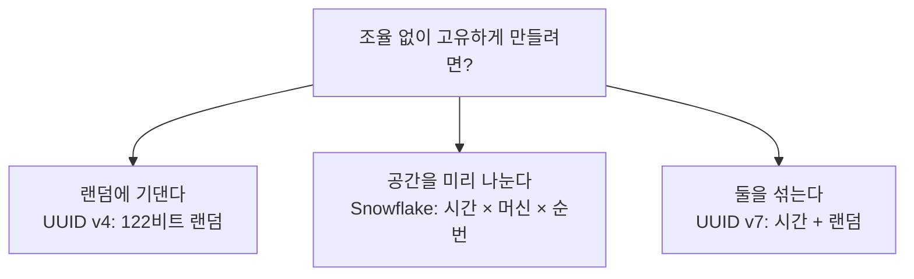

#### UUID

128비트다. hex 32글자에 하이픈 4개를 넣어 36글자로 쓴다. base64url이면 22글자다(2.5).

- **v4:** 버전 4비트와 variant 2비트를 빼면 122비트가 랜덤이다. 생성 순서와 값의 순서가 무관해서, DB 인덱스에 넣으면 B-tree 아무 데나 꽂힌다. 페이지가 쪼개지고 캐시가 식는다.
- **v7 (RFC 9562, 2024):** 앞 48비트가 밀리초 단위 Unix 시각이다. 그래서 정렬할 수 있고, 인덱스 끝에 순서대로 붙는다. 뒤쪽은 랜덤(과 선택적으로 카운터)이다.

1,000개씩 만들어서, 만든 순서대로 놓았을 때 값도 정렬되어 있는지 세어 보자.

```jsx live showLineNumbers
function Test_UUID_v4는_만든_순서와_값의_순서가_무관하다() {
  const ids = Array.from({ length: 1000 }, () => crypto.randomUUID());
  const inOrder = ids.filter((id, i) => i > 0 && id > ids[i - 1]).length;
  return `바로 앞 ID보다 큰 ID: ${inOrder} / 999 — 반쯤. 인덱스 아무 데나 꽂힌다`;
}
```

```jsx live noInline showLineNumbers
// 앞 48비트는 밀리초 시각, 그 뒤는 순번 + 랜덤 (v7 을 간단히 흉내 냈다)
const v7 = (i) => `${Date.now().toString(16).padStart(12, "0")}-7${i.toString(16).padStart(3, "0")}-${crypto.randomUUID().slice(19)}`;

function Test_UUID_v7은_만든_순서대로_정렬된다() {
  const ids = Array.from({ length: 1000 }, (_, i) => v7(i));
  const inOrder = ids.filter((id, i) => i > 0 && id > ids[i - 1]).length;
  return `바로 앞 ID보다 큰 ID: ${inOrder} / 999 — 전부. 인덱스 끝에 붙는다`;
}

render(Test_UUID_v7은_만든_순서대로_정렬된다);
```

#### Snowflake

트위터가 2010년에 만든 64비트 ID다.

| 비트 | 필드 | 뜻 |
|---|---|---|
| 1 | 부호 | 항상 0 (양수 유지) |
| 41 | 타임스탬프 | 기준 시각부터 밀리초. 약 69년 |
| 10 | 머신 ID | 1,024대 |
| 12 | 순번 | 밀리초당 4,096개 |

64비트 정수라 DB 인덱스와 궁합이 좋고, UUID의 절반 크기다. 대신 머신 ID를 겹치지 않게 **나눠 주는 관리**가 필요하다. 같은 밀리초에 여러 개를 만들어 보자.

```jsx live noInline showLineNumbers
const EPOCH = BigInt(1288834974657); // 트위터 기준 시각 (2010-11-04)
const machine = BigInt(7); // 서버마다 미리 나눠 준 번호
const make = (ms, seq) => ((ms - EPOCH) << BigInt(22)) | (machine << BigInt(12)) | BigInt(seq);

function Test_같은_밀리초에는_순번만_올라간다() {
  const now = BigInt(Date.now());
  return [0, 1, 2].map((seq) => make(now, seq).toString()).join(" / ");
}

render(Test_같은_밀리초에는_순번만_올라간다);
```

거꾸로, ID 하나만 있으면 비트를 잘라 언제 만들었는지 꺼낼 수 있다.

```jsx live noInline showLineNumbers
const EPOCH = BigInt(1288834974657); // 트위터 기준 시각 (2010-11-04)
const id = BigInt("2113549490114818048"); // 누군가에게 받은 주문번호

function Test_Snowflake_ID에서는_만든_시각이_보인다() {
  const ms = (id >> BigInt(22)) + EPOCH;
  return `이 ID는 ${new Date(Number(ms)).toISOString()} 에 만들어졌다`;
}

render(Test_Snowflake_ID에서는_만든_시각이_보인다);
```

같은 밀리초에는 맨 뒤 순번만 올라간다. 두 방식의 차이는 결국 **"조율을 언제 하느냐"** 다. UUID는 조율이 없는 대신 확률에 기댄다. Snowflake는 머신 ID를 **미리 한 번** 조율하고, 그 뒤로는 결정적으로 만든다.

:::info 자주 나오는 질문
- **"UUID 충돌이 정말 없나요?"** 초당 10억 개씩 만들어도 충돌 확률이 50%가 되려면 약 86년이 걸린다. 실무에서 UUID가 겹치면 거의 항상 랜덤 소스 문제다(시드 복제, VM 이미지 복제).
- **"auto increment를 쓰면 안 되나요?"** DB가 하나면 된다. 여러 대, 여러 리전이 되는 순간 "다음 번호"를 정하는 데 조율 비용이 생긴다. 그것이 이 절의 출발점이다.
:::

**생각할 문제**

- UUID v7은 앞 48비트가 시각이라 랜덤 비트가 v4보다 적다. 충돌 걱정이 커질까? 같은 밀리초에 몇 개까지 만들어도 괜찮을까?

- Snowflake 서버의 시계가 거꾸로 가면 어떻게 될까?

- 주문번호처럼 사용자에게 보여 줄 ID로 Snowflake를 쓰면 무엇이 새어 나갈까?

:::tip 데이터 형식 미학 체크리스트

**약속이 어디에 적혀 있는가?**

- 바이트 자신이 자기 형식을 알려 주는가(magic, UTF-8의 `10` 접두)? 아니면 확장자나 바깥 파일에 기대는가?
- 해석법(스키마)을 들고 다니는가, 바깥에 두는가? 그 데이터의 수명에 맞는 선택인가?
- 바깥 약속(`.proto`의 필드 번호, Snowflake의 시계)이 깨지면 무슨 일이 생기는가?

**표현력이 필요한 만큼인가?**

- 역직렬화기가 값만 만드는가, 함수를 찾아 부를 수 있는가? (`JSON.parse` vs `eval`/`pickle`/`yaml.load`)
- 그 데이터의 출처를 통제하는가? 못 한다면 코드를 표현할 수 없는 형식인가?

**직렬화/역직렬화를 태우는가?**

- 피할 수 있는가? (참조로 넘기기, transfer, 공유 메모리, zero-copy)
- 어떤 형식을 쓰는가? 압축하기 / 빨리 읽기 / 스키마 유연성 중 무엇을 얻고 무엇을 내줬는가?

:::

### 2.9 실습 — 저장공간 추측하기

ID 하나가 16바이트인지 8바이트인지가 왜 중요할까? 10억 개면 8 GB 차이다. 그 감각을 연습해 보자.

> **문제:** 사용자 1천만 명이 하루 50개의 이벤트를 남기고, 1년 보관한다. 이벤트 하나가 JSON으로 200바이트, 바이너리로 40바이트일 때 각각 얼마가 필요할까? 30초 동안 **자릿수만** 맞혀 보자.

페르미 추정이다. 정확한 값이 아니라 **자릿수**를 맞추는 연습이다.

1. 레코드 하나가 몇 바이트인가 (필드별로 더한다)
2. 하루에 몇 개 생기나
3. 며칠 보관하나
4. 인덱스, 복제본, 압축률을 곱한다 (인덱스 ×1.5, 복제 ×3, 압축 ×0.3 같은 어림값)

한 단계씩 같이 풀어 보자.

```jsx live noInline showLineNumbers
const perDay = 10_000_000 * 50; // 사용자 × 하루 이벤트

function Test_JSON_200바이트면_1년에_36TB다() {
  return `하루 ${perDay.toLocaleString()}건 × 200B × 365일 = ${(perDay * 200 * 365) / 1e12} TB`;
}

render(Test_JSON_200바이트면_1년에_36TB다);
```

```jsx live noInline showLineNumbers
const perDay = 10_000_000 * 50; // 사용자 × 하루 이벤트

function Test_바이너리로_바꾸면_5분의_1이다() {
  return `40B 로 바꾸면 ${(perDay * 40 * 365) / 1e12} TB`;
}

render(Test_바이너리로_바꾸면_5분의_1이다);
```

```jsx live noInline showLineNumbers
const raw = 36.5;   // TB, JSON 원본
const replicas = 3; // 복제 3벌
const index = 1.5;  // 인덱스

function Test_복제와_인덱스를_잊으면_자릿수가_틀린다() {
  return `원본 ${raw} TB → 실제로는 ${raw * replicas * index} TB`;
}

render(Test_복제와_인덱스를_잊으면_자릿수가_틀린다);
```

이제 "어디서 10배가 튀는가"를 찾아 보자. 대부분 **복제본과 인덱스를 잊는다.** 그리고 형식 선택(JSON 200B vs 바이너리 40B)만으로 5배가, 압축(2.6)으로 다시 몇 배가 갈린다. 형식은 취향이 아니라 **청구서**다.

여기까지가 "바이트를 어떻게 끊어 읽나"였다. 이제 그 바이트 **앞뒤에 무엇을 붙이는지**, 왜 붙이는지 보자.

---

## 3. 덧붙이기: 헤더 / 타입 / 서명

2절에서 본 형식들, ELF·protobuf·BSON이 전부 같은 패턴을 갖고 있었다. 무엇이었을까? **본문 앞에 무언가를 붙였다.** 이 절은 그 "붙이는 것들"의 이야기다.

### 3.1 현실 예시 — 택배 상자

택배 하나를 부친다고 하자. 물건은 상자에 들어가고, 상자에는 여러 겹의 정보가 붙는다.

- 상자 안에는 **물건**(payload)이 있다.
- 상자 겉에는 **"깨짐 주의 · 이쪽이 위"** 스티커가 붙는다. 상자를 들어 옮기는 사람을 위한 정보다(type).
- 그 위에 **운송장**이 붙는다. 보내는 사람, 받는 사람, 무게. 터미널의 분류기를 위한 정보다(length, 주소).
- 입구에는 **봉인 테이프**가 붙는다. 받는 사람이 "중간에 누가 열지 않았다"를 확인하기 위한 것이다(signature).

재미있는 점은 **누구도 상자를 열지 않는다**는 것이다. 분류기는 운송장만 읽고, 기사는 주소만 읽고, 받는 사람만 봉인을 확인하고 상자를 연다. 각자 **자기 몫의 정보만** 읽고 나머지는 그대로 넘긴다. 그래서 택배 회사는 물건이 책이든 그릇이든 상관없이 같은 절차로 일한다. **절차 하나가 모든 물건에 재사용된다.**

데이터도 똑같다.

### 3.2 데이터 앞뒤에 붙는 것들

**데이터가 경계를 건널 때마다 건너편이 알아야 할 메타정보가 하나씩 붙고, 그것이 헤더다. 헤더가 붙는 곳이 계층의 경계이고, 계층은 자기 헤더만 읽고 나머지는 불투명하게 넘긴다.**

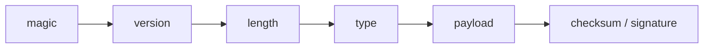

#### 반복되는 패턴: TLV

**TLV(type-length-value)** 패턴은 여러 곳에서 반복된다. 2.1 ELF 헤더, 2.6 protobuf의 tag, 2.7 BSON의 타입 바이트와 길이, 그리고 PNG의 chunk.

:::note PNG의 첫 8바이트 — "깨졌다"를 알아채기 위한 설계
PNG 파일은 항상 `89 50 4E 47 0D 0A 1A 0A`로 시작한다.

- `50 4E 47`은 ASCII로 `PNG`다. 사람이 hexdump로 봐도 알아볼 수 있다.
- 맨 앞 `89`는 ASCII 범위(0\~127) 밖의 바이트다. 2진수로 `1000 1001`, 맨 앞 비트가 1이다.
  - ASCII 글자는 7비트(0\~127)면 다 표현되기 때문에, 맨 앞 비트는 늘 0이다. 그래서 옛 이메일 서버나 통신 회선 중에는 "텍스트만 지나간다"고 보고 이 8번째 비트를 **버리거나 오류 검사용으로 덮어쓰는** 것들이 있었다. 텍스트는 멀쩡히 지나가지만, 이미지 같은 바이너리는 바이트마다 맨 앞 비트가 날아가 조용히 망가진다.
  - 이런 통로를 지나면 `89`(`1000 1001`)는 `09`(`0000 1001`, 탭 문자)가 된다. PNG 디코더는 첫 바이트가 `89`가 아닌 것을 보고 **"8비트가 깨지는 통로를 지나왔다"** 를 바로 알아챈다. 파일 중간 어딘가가 깨진 것을 한참 뒤에 발견하는 대신, 첫 바이트에서 멈춘다.
  - 덤으로, 첫 바이트가 텍스트 글자가 아니라서 프로그램이 PNG 파일을 텍스트 파일로 착각할 일도 줄어든다.
- `0D 0A`는 CRLF, 그 뒤의 `0A`는 LF다. 텍스트 모드로 잘못 전송되어 줄바꿈이 변환되면 이 바이트들이 바뀐다.
- `1A`는 DOS에서 파일 끝으로 취급되는 문자다. DOS에서 `type` 명령으로 파일을 찍으면 여기서 멈춘다.

이 8바이트는 "PNG다"라고 알려 주는 것을 넘어, 전송로가 파일을 망가뜨렸으면 **열자마자 알 수 있게** 설계되어 있다. magic 하나에 이렇게 많은 약속이 들어 있다.

PNG 본문은 chunk의 나열이고, chunk는 `길이(4) 타입(4) 데이터 CRC(4)`다. 모르는 타입의 chunk는 건너뛸 수 있다. **길이가 있으니까** 가능하다.
:::

#### 경계를 건널 때마다 메타정보가 붙는다

헤더는 누가 왜 붙일까? 데이터가 **경계를 하나 건널 때마다**, 건너편에서 받는 쪽이 "이걸 어떻게 다뤄야 하는지" 알아야 할 정보가 하나씩 생긴다. 그 정보를 payload 앞뒤에 붙인 것이 헤더다. 헤더의 필드 하나하나는 **데이터가 어떤 경계를 건넜는지의 흔적**이다.

| 건너는 경계 | 건너편이 알아야 하는 것 | 붙는 메타정보 | 예 |
|---|---|---|---|
| 메모리 → 바이트 스트림 | 어디서 끝나나 | length | TCP 위의 메시지 경계, BSON 문서 길이 |
| 한 통로에 여러 형식이 섞임 | 무엇인가, 어떤 디코더를 쓰나 | type | `Content-Type`, BSON 타입 바이트, protobuf tag |
| 지금 → 미래 (디스크, 아카이브) | 어떤 규칙으로 읽나 | magic, version | ELF, PNG 시그니처, pickle 프로토콜 번호 |
| 믿을 수 없는 전송로 | 깨지지 않았나 | checksum | PNG CRC, TCP checksum |
| 신뢰 경계 (다른 조직, 사용자) | 바뀌지 않았나, 누가 보냈나 | signature | JWT, 3.3의 토큰 |
| 텍스트만 다니는 통로 | (통과하기 위한 변환) | base64 | JWT, data URI (2.5) |
| 좁은 통로 | (크기를 줄이는 변환) | 압축 + 압축했다는 표시 | `Content-Encoding: gzip` |

받는 쪽은 반대로 한다. 경계를 하나 거꾸로 건널 때마다 자기 몫의 메타정보를 **읽고 뗀 뒤**, 나머지는 손대지 않고 안쪽으로 넘긴다.

#### 헤더가 붙는 곳이 계층의 경계다

"경계마다 메타정보를 붙이고 떼는 한 쌍"이 쌓이면 **계층**이 생긴다. 계층이란 거창한 것이 아니다. 자기 헤더만 읽고 쓰고, 나머지는 불투명한 bytes로 다루는 코드 한 덩어리다.

계층의 규칙은 두 가지다.

- **자기 헤더만 본다.** 안쪽에 무엇이 들었는지 모르고, 알려고 하지도 않는다.
- **보내는 쪽은 안쪽 계층부터 바깥으로 붙이고, 받는 쪽은 바깥 계층부터 안으로 뗀다.** 벗기는 순서는 씌운 순서의 역순이다.

이 규칙 덕분에 계층을 하나씩 **따로 바꿀 수 있다.** 네트워크 스택이 가장 큰 예다. HTTP 메시지는 TCP 세그먼트의 payload이고, TCP 세그먼트는 IP 패킷의 payload이고, IP 패킷은 Ethernet 프레임의 payload다. HTTP를 바꾸지 않고 TCP를 QUIC으로 바꿀 수 있고, IPv4를 IPv6으로 바꿔도 TCP는 모른다. 네트워크에서는 이것을 **캡슐화**라고 부른다.

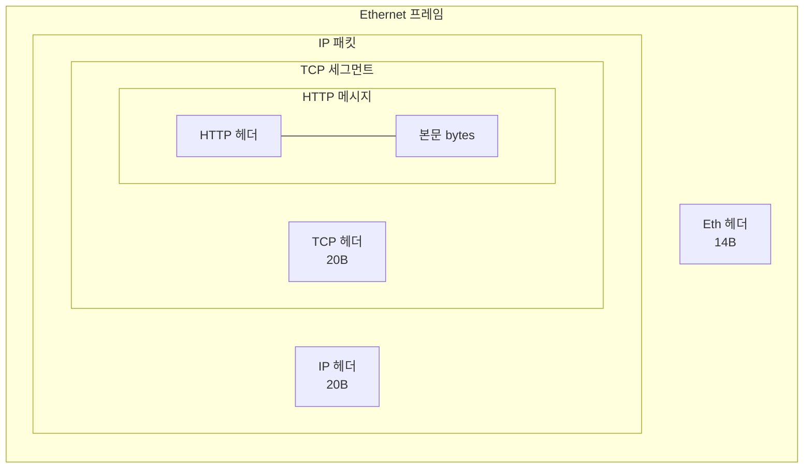

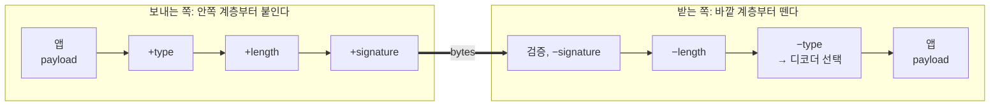

코드로 보면 계층 하나는 `wrap`(붙이기)과 `unwrap`(떼기) 한 쌍이다. 보내는 쪽과 받는 쪽이 **같은 계층 목록을 반대 순서로** 적용한다.

```js
// 계층 하나 = 경계를 건널 때 메타정보를 붙이고(wrap) 떼는(unwrap) 한 쌍
const typing = {
  wrap:   (b, tag) => concat([tag], b),
  unwrap: (b) => ({ tag: b[0], body: b.slice(1) }),       // tag로 디코더를 고른다
};
const framing = {
  wrap:   (b) => concat(u32(b.length), b),
  unwrap: (b) => b.slice(4, 4 + readU32(b)),
};
const signing = {
  wrap:   async (b) => concat(b, await hmac(key, b)),
  unwrap: async (b) => { await verify(key, b); return b.slice(0, -32); },
};

// 보내는 쪽: 안쪽 계층부터 바깥으로
const wire = await signing.wrap(framing.wrap(typing.wrap(payload, JSON_TAG)));

// 받는 쪽: 바깥 계층부터 안으로. 각 계층은 자기 헤더만 보고 나머지는 그대로 넘긴다
const { tag, body } = typing.unwrap(framing.unwrap(await signing.unwrap(wire)));
decoders[tag](body);

// 압축 계층을 끼워 넣어도 다른 계층은 한 줄도 바뀌지 않는다
// const wire = await signing.wrap(zipping.wrap(framing.wrap(typing.wrap(payload, JSON_TAG))));
```

실제로 겹쳐 보자. 바이트 대신 문자열로, 각 계층이 자기 표시를 붙이고 떼는 것만 흉내 낸다.

```jsx live noInline showLineNumbers
// 계층 하나 = 자기 표시를 붙이고(wrap) 떼는(unwrap) 한 쌍
const layer = (name) => ({
  wrap: (s) => `${name}[${s}]`,
  unwrap: (s) => {
    if (!s.startsWith(`${name}[`)) throw new Error(`${name} 를 기대했는데 ${s.slice(0, 5)}… 가 왔다`);
    return s.slice(name.length + 1, -1);
  },
});
const layers = [layer("type"), layer("len"), layer("sig")]; // 안쪽 → 바깥

function Test_계층은_안쪽부터_붙이고_바깥부터_뗀다() {
  const wire = layers.reduce((s, l) => l.wrap(s), "hello");
  const body = [...layers].reverse().reduce((s, l) => l.unwrap(s), wire);
  return `${wire} → ${body}`;
}

render(Test_계층은_안쪽부터_붙이고_바깥부터_뗀다);
```

압축 계층을 하나 끼워 보자.

```jsx live noInline showLineNumbers
// 계층 하나 = 자기 표시를 붙이고(wrap) 떼는(unwrap) 한 쌍
const layer = (name) => ({
  wrap: (s) => `${name}[${s}]`,
  unwrap: (s) => {
    if (!s.startsWith(`${name}[`)) throw new Error(`${name} 를 기대했는데 ${s.slice(0, 5)}… 가 왔다`);
    return s.slice(name.length + 1, -1);
  },
});
const layers = [layer("type"), layer("len"), layer("zip"), layer("sig")]; // zip 한 줄만 추가

function Test_압축_계층을_끼워도_다른_계층은_그대로다() {
  const wire = layers.reduce((s, l) => l.wrap(s), "hello");
  const body = [...layers].reverse().reduce((s, l) => l.unwrap(s), wire);
  return `${wire} → ${body}`;
}

render(Test_압축_계층을_끼워도_다른_계층은_그대로다);
```

받는 쪽이 벗기는 순서를 틀리면?

```jsx live noInline showLineNumbers
// 계층 하나 = 자기 표시를 붙이고(wrap) 떼는(unwrap) 한 쌍
const layer = (name) => ({
  wrap: (s) => `${name}[${s}]`,
  unwrap: (s) => {
    if (!s.startsWith(`${name}[`)) throw new Error(`${name} 를 기대했는데 ${s.slice(0, 5)}… 가 왔다`);
    return s.slice(name.length + 1, -1);
  },
});
const layers = [layer("type"), layer("len"), layer("sig")];
const wire = layers.reduce((s, l) => l.wrap(s), "hello");

function Test_벗기는_순서를_틀리면_실패한다() {
  try {
    return layers.reduce((s, l) => l.unwrap(s), wire); // 바깥이 아니라 안쪽부터 떼려 했다
  } catch (e) {
    return e.message;
  }
}

render(Test_벗기는_순서를_틀리면_실패한다);
```

압축 계층을 끼워도 다른 계층의 코드는 한 줄도 바뀌지 않는다. 대신 **순서**는 약속의 일부다. 벗기는 순서를 틀리면 바로 실패한다.

소프트웨어에서도 같은 모양을 자주 본다. 웹 프레임워크의 **미들웨어 체인**이 그렇다. 요청이 들어올 때 각 미들웨어가 자기 몫(세션, 인증, 압축 해제)을 읽고 떼어 안쪽 핸들러로 넘기고, 응답이 나갈 때는 반대 순서로 붙인다. 각 미들웨어는 다른 미들웨어가 무엇을 하는지 모른다.

#### type 태그 — 데이터 수준의 다형성

type 태그는 받는 쪽이 **"다음 계층을 어떤 디코더에 맡겨야 하는지"** 를 알게 해 준다. 그래서 전송·저장·라우팅 파이프라인은 type만 읽고 payload는 불투명한 bytes로 다룰 수 있다.

- 새 형식을 추가해도 파이프라인 코드는 바뀌지 않는다. **디코더 하나를 등록하면 끝이다.** OOP에서 말하는 개방-폐쇄 원칙이 데이터 수준에서 그대로 나타난다.
- type으로 분기하는 것은 데이터 수준의 다형성이다. 코드에서 가상 함수 테이블이 하던 일을 데이터에서는 type 바이트가 한다.
- 2.7의 self-contained와도 이어진다. type 태그는 "해석법을 들고 다니는" 최소한의 형태다.

`handle` 함수 하나가 `{ type, payload }` 봉투를 읽고 등록된 디코더에 넘긴다. (바이트 대신 객체로 흉내 냈다.)

```jsx live noInline showLineNumbers
const decoders = { json: JSON.parse, csv: (text) => text.split(",") };
const handle = (env) => decoders[env.type](env.payload); // payload 는 열어 보지 않고 그대로 넘긴다

function Test_파이프라인은_type만_보고_디코더를_고른다() {
  return JSON.stringify([handle({ type: "json", payload: '{"n":3}' }), handle({ type: "csv", payload: "alice,3" })]);
}

render(Test_파이프라인은_type만_보고_디코더를_고른다);
```

```jsx live noInline showLineNumbers
const decoders = { json: JSON.parse, csv: (text) => text.split(",") };
const handle = (env) => decoders[env.type](env.payload); // payload 는 열어 보지 않고 그대로 넘긴다

function Test_디코더를_등록하면_handle은_그대로_새_형식을_푼다() {
  decoders.kv = (text) => Object.fromEntries(text.split(";").map((p) => p.split("="))); // 등록만 했다. handle 은 그대로
  return JSON.stringify(handle({ type: "kv", payload: "user=carol;n=7" }));
}

render(Test_디코더를_등록하면_handle은_그대로_새_형식을_푼다);
```

```jsx live noInline showLineNumbers
const decoders = { json: JSON.parse };
const handle = (env) =>
  env.type in decoders ? decoders[env.type](env.payload) : `모르는 형식 "${env.type}" — 거절 (payload 는 열어 보지 않았다)`;

function Test_모르는_type은_열어_보지_않고_거절한다() {
  return handle({ type: "xml", payload: "<a/>" });
}

render(Test_모르는_type은_열어_보지_않고_거절한다);
```

실제 시스템에서도 같은 구조가 반복된다.

| 어디 | 바깥 계층이 읽는 것 | 불투명한 payload | 안쪽 계층이 하는 일 |
|---|---|---|---|
| HTTP | `Content-Type`, `Content-Length`, `Content-Encoding` | body | 서버·브라우저가 Content-Type을 보고 파서를 고른다 |
| 메시지 큐 (Kafka 등) | key, headers, 길이 | value bytes | 브로커는 value를 열어 보지 않는다. 컨슈머가 헤더로 역직렬화기를 고른다 |
| 스키마 레지스트리 | magic 1바이트 + 스키마 ID 4바이트 | Avro/protobuf bytes | ID로 스키마를 찾아 디코더를 만든다 (2.7의 "어디 있는지만 알려 준다") |
| protobuf `Any` | `type_url` | `value` bytes | 고정된 슬롯에 아무 메시지나 담고, 받는 쪽이 type_url로 푼다 |
| 컨테이너 포맷 (MP4, MKV, ZIP) | 트랙/엔트리 목록, 코덱 ID | 압축된 스트림 | 플레이어는 컨테이너만 읽고 코덱에 넘긴다 |
| 이벤트 봉투 (CloudEvents 등) | id, source, type, time | data | 라우터가 봉투만 보고 어디로 보낼지 정한다 |

택배 회사가 물건을 열지 않고 운송장만으로 일하는 것과 정확히 같다.

#### 순서와 비용

- **순서가 중요하다.** 서명한 뒤 압축하면 받는 쪽은 압축을 풀고 서명을 확인해야 한다. 압축한 뒤 서명하면 반대다. 위에서 본 것처럼 받는 쪽이 이 순서를 틀리면 바로 실패한다.
- **계층을 겹칠수록 헤더가 쌓인다.** "Hello" 5바이트를 보내려면 HTTP 헤더 수백 바이트에 TCP/IP/Ethernet 54바이트가 붙는다. 2.6에서 본 "압축하기 vs 스키마 유연성" 트레이드오프가 여기서도 나타난다. 그래서 작은 메시지가 많으면 **묶어서 보낸다**(batching, 2장 "배칭과 풀링").

#### checksum과 서명은 다르다

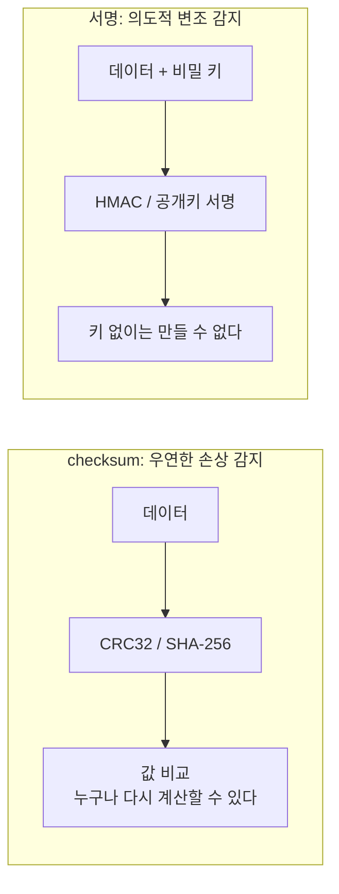

- **checksum**은 디스크 오류나 전송 오류를 잡는다. 하지만 공격자는 데이터를 바꾸고 checksum도 다시 계산하면 그만이다. 알고리즘은 공개되어 있고 키가 없으니까.
- **서명**은 키가 있어야 만들 수 있다. 받는 쪽은 "키를 가진 쪽이 보낸 그대로"라는 것을 안다. 다만 **내용을 숨기지는 않는다.**

변조 방지를 checksum에 맡기면 sensible한가, smelly한가? 직접 돌려보자. (아래 checksum과 서명은 간략화한 버전이다.)

```jsx live noInline showLineNumbers
const checksum = (s) => [...s].reduce((sum, c) => sum + c.charCodeAt(0), 0); // 알고리즘은 공개돼 있다
const tampered = '{"to":"mallory","amount":1000000}'; // 공격자가 바꾼 내용

function Test_checksum은_변조한_쪽이_다시_계산하면_통과한다() {
  const attached = checksum(tampered); // 바꾼 뒤 다시 계산해서 붙였다
  return checksum(tampered) === attached ? "검증 통과 — 변조를 못 잡았다" : "검증 실패";
}

render(Test_checksum은_변조한_쪽이_다시_계산하면_통과한다);
```

```jsx live noInline showLineNumbers
const sign = (key, s) => [...(key + s)].reduce((h, c) => (h * 31 + c.charCodeAt(0)) >>> 0, 7);
const SERVER_KEY = "only-the-server-knows";
const tampered = '{"to":"mallory","amount":1000000}'; // 공격자가 바꾼 내용

function Test_서명은_키_없이_다시_만들_수_없다() {
  const attached = sign("guessed-key", tampered); // 키를 모르니 추측할 뿐
  return sign(SERVER_KEY, tampered) === attached ? "검증 통과" : "검증 실패 — 키 없이는 서명을 만들 수 없다";
}

render(Test_서명은_키_없이_다시_만들_수_없다);
```

#### JWT — 세 겹의 봉투

**JWT**는 `header.payload.signature`를 각각 base64url로 쓰고 `.`으로 잇는다. header에 서명 알고리즘, payload에 주장(claims), signature에 HMAC이나 공개키 서명이 들어간다. 즉 `base64url(서명(JSON))`이라는 세 겹 봉투다. 토큰 하나를 키 없이 뜯어 보자.

```jsx live noInline showLineNumbers
const payload = btoa(JSON.stringify({ sub: "alice", role: "user" })); // 간단히 base64url 대신 base64
const token = `eyJhbGciOiJIUzI1NiJ9.${payload}.c2lnbmF0dXJl`;        // 서버가 발급한 토큰

function Test_JWT_payload는_키_없이_읽힌다() {
  const [, body] = token.split(".");
  return `payload: ${atob(body)} — 서명은 읽기를 막지 않는다`;
}

render(Test_JWT_payload는_키_없이_읽힌다);
```

키 없이 payload가 그대로 읽힌다. **서명은 변조를 막고, 암호화는 읽기를 막는다.** 둘은 다른 도구다. base64는 숨기는 것이 아니라 텍스트 통로를 통과시키는 변환일 뿐이다(2.5).

JWT에는 유명한 설계 교훈이 하나 더 있다. header의 `alg`를 그대로 믿고 그 알고리즘으로 검증하면, **보낸 쪽이 검증 방법을 골라 버리는 셈**이 된다(예: `alg: "none"`을 받아들이는 검증기). 검증하는 쪽이 허용할 알고리즘을 **미리 정해 두어야** 한다.

```js
// ❌ 데이터 안에 적힌 해석 방법을 믿는다
jwt.verify(token, key);                              // 일부 옛 라이브러리는 header.alg 를 그대로 따랐다
// ✅ 해석 방법은 받는 쪽이 정한다
jwt.verify(token, key, { algorithms: ["HS256"] });
```

**데이터 안에 적힌 해석 방법을 믿지 말라.** 2.3의 pickle에서 본 것과 같은 원칙이다. pickle은 "어떤 함수를 부를지"를, JWT header는 "어떻게 검증할지"를 데이터가 고르게 했다.

:::info 자주 나오는 질문 — "헤더가 너무 쌓이면 낭비 아닌가요?"
맞다. 그래서 작은 메시지를 묶어 보내고(batching), HTTP/2는 헤더를 압축한다(HPACK). 계층이 주는 독립성의 대가를 헤더 크기로 치르는 것이고, 그 대가가 너무 크면 묶어서 나눠 낸다.
:::

**생각할 문제**

- JWT 서명 키가 유출되면 무엇이 가능해질까? 이미 발급한 토큰은 어떻게 할까?

- 헤더에 version 필드가 없는 형식을 바꿔야 할 때는 어떻게 할까?

- `Content-Type` 헤더가 없는 HTTP 응답을 받으면 브라우저는 어떻게 할까?

- 파이프라인이 payload를 불투명하게 다루면 무엇을 얻고 무엇을 잃을까?

- 서명을 붙이면 어떤 데이터든 안심하고 열어도 될까? (2.3의 결정 트리에서 서명이 혼자가 아니라 허용 목록과 함께 있던 이유를 떠올려 보자.)

:::tip 덧붙이기 미학 체크리스트

**약속이 어디에 적혀 있는가?**

- 받는 쪽이 알아야 할 것(어디서 끝나나, 무엇인가, 어떤 버전인가)이 헤더에 다 있는가? 처음부터 version이 있는가?
- 라우팅에 필요한 값이 헤더로 올라와 있는가, payload를 열어야만 알 수 있는가?

**표현력이 필요한 만큼인가?**

- 각 계층이 자기 헤더만 보는가? 안쪽 내용을 알아야만 동작하는 계층은 없는가?
- 새 형식을 추가할 때 파이프라인 코드를 고쳐야 하는가, 디코더 하나만 등록하면 되는가?
- 해석 방법(`alg`, 호출할 함수)을 데이터가 고르게 두지 않았는가?
- 막으려는 것에 맞는 도구인가? 우연한 손상(checksum), 의도적 변조(서명), 엿보기(암호화)?

**직렬화/역직렬화를 태우는가?**

- 계층마다 payload를 풀었다 다시 싸고 있지 않은가? 불투명하게 넘길 수 있는가?
- 어떤 형식을 쓰는가? 헤더가 payload보다 크지 않은가? 묶어서 보낼 수 있는가?

:::

### 3.3 실습 — 제안과 수락 짝짓기 (nonce)

방금 서명 이야기가 나왔다. 이제 그걸로 설계를 하나 해 보자. **정답은 없다.**

> **문제:** 마케팅 제안을 주는 API `POST /provide-promotion`이 있다. 예를 들어 "이 사용자에게 30% 할인"을 제안한다. 사용자가 수락하면 `POST /provide-promotion/approve`를 호출한다. approve가 **"실제로 우리가 준 그 제안"** 에 대한 수락이라는 것을 어떻게 보장할까? 둘을 어떻게 짝지을까?

먼저 3분 동안 요청과 응답에 무엇이 들어가야 하는지만 적어 보자. 그다음 아래 시나리오를 하나씩 대 보며 내 설계가 버티는지 확인한다. 뚫리면 그 자리에서 고친다.

| # | 상황 | 생각할 거리 |
|---|---|---|
| A | approve에 `discount: 90`을 직접 넣어 보낸다 (위조) | 제안 내용을 누가 기억하나? 클라이언트가 들고 있어도 되나? |
| B | promotion id를 1, 2, 3… 순서대로 넣어 본다 (추측) | id는 추측할 수 없어야 한다 (2.8 UUID v4, 2.5 base64url) |
| C | 다른 사용자가 받은 제안을 자기 것으로 approve한다 (양도) | 제안은 누구 것인가? 로그인 사용자와 대조하나? |
| D | 같은 approve를 두 번 보낸다 (replay) | 한 번만 쓰이게 하려면 무엇을 기억해야 하나? → **nonce** |
| E | 일주일 지난 제안을 approve한다 (만료) | 제안에 유효기간이 있나? 어디에 적나? |
| F | approve 응답이 유실되어 클라이언트가 재시도한다 | D와 어떻게 구분하나? 두 번째 요청에 뭐라고 답하나? |

D와 F는 [2장의 "90% 할인 이벤트 프로토콜"](../ch02/) 실습에서 본 **멱등성 키** 이야기와 닿아 있다. 다른 점은, 이번에는 "중복 발급"이 아니라 **"우리가 준 그 제안인가"** 를 함께 증명해야 한다는 것이다.

<details>
<summary>대표 답안 두 가지 — 펼쳐보기 (무수한 설계 중 한 방법일 뿐이다)</summary>

| | 답안 1: 서버가 기억한다 (stateful) | 답안 2: 토큰에 담아 서명한다 (stateless + nonce) |
|---|---|---|
| provide | 제안을 DB에 저장하고 랜덤 id만 내려준다 | `{user_id, promo, exp, nonce}`에 HMAC 서명을 붙여 토큰으로 내려준다 (3.2) |
| approve | id로 조회 → 소유자·만료·상태 확인 → 상태를 "수락"으로 바꾼다 | 서명 검증 → exp·user 확인 → nonce 저장소에 "쓴 적 있나" 확인 후 기록 |
| 저장하는 것 | 모든 제안 | 수락된 nonce만 (exp까지, TTL) |
| 좋은 점 | 제안을 취소·조회·분석하기 쉽다. 상태 머신이 명확하다 | 저장량이 적다. 제안 서버와 수락 서버가 DB를 공유하지 않아도 된다 |
| 치르는 것 | 제안은 많고 수락은 적어서 저장이 아깝다. DB가 단일 지점이 된다 | 토큰이 크다. 발급 후 취소가 어렵다(블랙리스트 필요). 키 관리가 필요하다 |
| 시나리오 F | 상태가 이미 "수락"이면 같은 결과를 돌려준다 | nonce 기록에 처리 결과도 저장해서 같은 결과를 돌려준다 |

두 답안 모두 F에서 같은 결론에 닿는다. **두 번째 요청에는 에러가 아니라 처음 결과를 그대로 돌려준다(멱등).** D(replay)와 F(재시도)는 요청 모양이 똑같아서 서버는 둘을 구분할 수 없다. **구분할 필요가 없게 만드는 것**이 답이다.

실무에서는 둘을 섞기도 한다. 토큰으로 검증하되, 수락 사실은 DB에 남긴다.

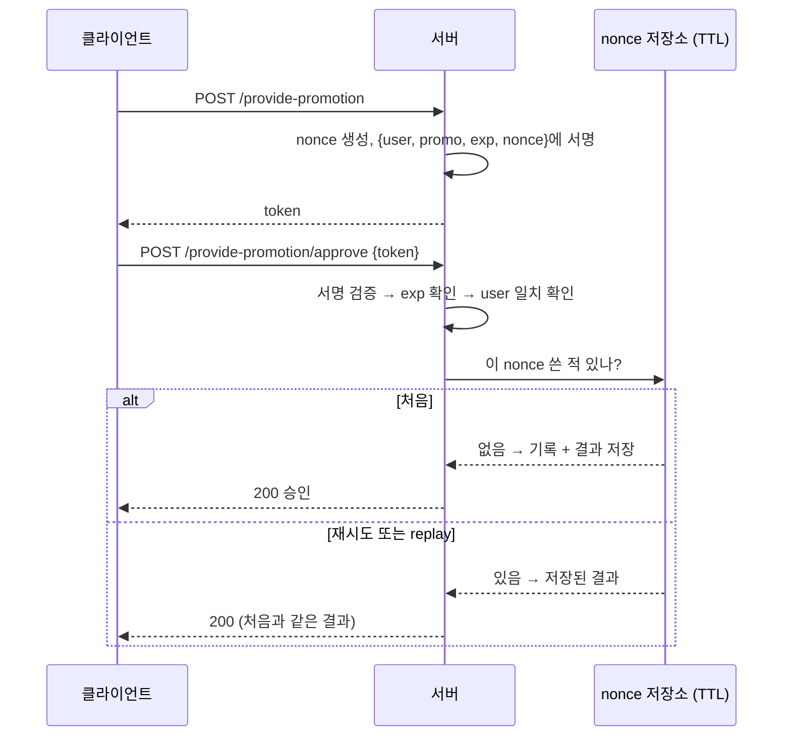

</details>

답안 2를 가짜 서버로 흉내 내 보자. 방어 요소를 하나씩 빼 보면 어떤 시나리오가 뚫리는지 보인다. 먼저 서명이 없으면? sensible한가, smelly한가?

```jsx live noInline showLineNumbers
const approve = (token) => `승인: ${token.user} ${token.discount}% 할인`; // 토큰을 그대로 믿는다
const token = { user: "alice", discount: 30, nonce: "n1" }; // provide 가 내려준 토큰

function Test_서명이_없으면_할인율을_바꿔치기할_수_있다() {
  return approve({ ...token, discount: 90 }); // 클라이언트가 숫자를 고쳐 보냈다
}

render(Test_서명이_없으면_할인율을_바꿔치기할_수_있다);
```

```jsx live noInline showLineNumbers
const sign = (t) => [..."server-secret" + JSON.stringify(t)].reduce((h, c) => (h * 31 + c.charCodeAt(0)) >>> 0, 7);
const approve = ({ body, sig }) => (sign(body) === sig ? `승인: ${body.discount}% 할인` : "거절: 서명 불일치");
const body = { user: "alice", discount: 30, nonce: "n1" };
const token = { body, sig: sign(body) }; // provide 가 내려준 서명된 토큰

function Test_서명하면_바꿔치기가_막힌다() {
  return approve({ ...token, body: { ...body, discount: 90 } }); // 내용만 고치고 서명은 그대로
}

render(Test_서명하면_바꿔치기가_막힌다);
```

서명이 있어도 토큰이 **누구 것인지** 확인하지 않으면?

```jsx live noInline showLineNumbers
const approve = (token, loginUser) => `승인: ${loginUser} ${token.discount}% 할인`; // token.user 를 안 본다
const token = { user: "alice", discount: 30, nonce: "n1" }; // provide 가 내려준 토큰

function Test_user를_묶지_않으면_남의_제안을_수락할_수_있다() {
  return approve(token, "bob"); // alice 의 토큰을 bob 이 보냈다
}

render(Test_user를_묶지_않으면_남의_제안을_수락할_수_있다);
```

같은 요청이 두 번 오면?

```jsx live noInline showLineNumbers
let granted = 0;
const approve = (token) => { granted++; return "승인"; };
const token = { user: "alice", discount: 30, nonce: "n1" }; // provide 가 내려준 토큰

function Test_nonce가_없으면_같은_제안이_두_번_수락된다() {
  approve(token);
  approve(token); // 같은 요청을 한 번 더
  return `할인 적용 ${granted}번`;
}

render(Test_nonce가_없으면_같은_제안이_두_번_수락된다);
```

```jsx live noInline showLineNumbers
const used = new Set();
const approve = (token) => {
  if (used.has(token.nonce)) return "거절: 이미 사용됨";
  used.add(token.nonce);
  return "승인";
};
const token = { user: "alice", discount: 30, nonce: "n1" }; // provide 가 내려준 토큰

function Test_nonce만_기록하면_정상_재시도가_에러를_받는다() {
  approve(token); // 처리는 됐는데 응답이 유실됐다
  return `재시도 → ${approve(token)} (할인은 적용됐는데 사용자는 실패로 본다)`;
}

render(Test_nonce만_기록하면_정상_재시도가_에러를_받는다);
```

```jsx live noInline showLineNumbers
const results = new Map(); // nonce → 처음 결과
let granted = 0;
const approve = (token) => {
  if (results.has(token.nonce)) return results.get(token.nonce); // 처음 결과를 그대로
  granted++;
  results.set(token.nonce, `승인: ${token.user} ${token.discount}% 할인`);
  return results.get(token.nonce);
};
const token = { user: "alice", discount: 30, nonce: "n1" }; // provide 가 내려준 토큰

function Test_결과까지_저장하면_replay와_재시도가_같은_답을_받는다() {
  approve(token);
  return `두 번째 요청 → ${approve(token)} / 실제 할인 적용 ${granted}번`;
}

render(Test_결과까지_저장하면_replay와_재시도가_같은_답을_받는다);
```

nonce만 기록하면 D는 막히지만 F가 뚫린다. 정상 사용자의 재시도가 "이미 사용됨" 에러를 받기 때문이다. 할인은 적용되었는데 사용자는 실패했다고 본다. 처음 결과까지 저장해야 D와 F가 **같은 방법으로** 둘 다 해결된다.

:::info 자주 나오는 질문 — "HTTPS면 replay를 못 하지 않나요?"
HTTPS는 전송로의 도청과 변조를 막는다. 하지만 **클라이언트 자신이 같은 요청을 다시 보내는 것**은 못 막는다. F가 바로 그 경우다. 악의가 없어도 재시도는 일어난다.
:::

**토론 거리**

- nonce(서버가 발급, 한 번만 사용)와 idempotency key(클라이언트가 발급, 재시도 식별)는 어떻게 다를까? 둘 다 필요한 경우는?

<details>
<summary>생각해 볼 방향 — 펼쳐보기</summary>

nonce는 **서버가** "이 제안은 내가 준 것이고 한 번만 쓰인다"를 보증하려고 만든다. idempotency key는 **클라이언트가** "이 요청과 저 요청은 같은 의도다"를 알리려고 만든다. 이번 문제처럼 제안이 서버에서 나오면 nonce가 idempotency key 역할까지 겸할 수 있다. 반대로 결제처럼 클라이언트가 먼저 요청을 시작하는 흐름에서는 idempotency key가 필요하고, 그 결제가 "우리가 낸 청구서"에 대한 것인지까지 확인하려면 둘 다 필요하다.

</details>

- 짝짓기는 보안에만 필요할까? "어떤 제안이 수락으로 이어졌나"(노출 → 전환)를 집계할 때도 같은 id가 join key가 된다. 답안 2에서는 이 분석을 어떻게 할까?

<details>
<summary>생각해 볼 방향 — 펼쳐보기</summary>

답안 2는 수락된 nonce만 저장하므로, "수락되지 않은 제안"은 서버 어디에도 남지 않는다. 전환율을 보려면 provide 시점에 nonce를 **로그나 이벤트로** 따로 남겨야 한다. 상태를 DB에 두지 않기로 했어도, 분석용 기록은 다른 곳에 남게 된다. 상태를 어디에 둘지가 두 답안을 가르는 갈림길이고, 그 선택은 분석까지 따라온다.

</details>

- 토큰 안의 promo 내용을 사용자가 읽어도 괜찮을까? 안 된다면 서명이 아니라 무엇이 필요할까? (서명은 변조를 막고, 암호화는 읽기를 막는다.)

지금까지는 **데이터**를 보냈다. 이제 **할 일**을 보내야 한다면?

---

## 4. 절차의 표현

데이터가 아니라 **"무엇을 할지"** 를 바이트로 보내야 할 때는 어떻게 표현할까? 2.3에서 함수를 통째로 보내면 위험하다고 했다. 그러면 절차를 안전하게 표현하는 방법은 무엇일까?

### 4.1 현실 예시 — 식당에서 주문하기

식당에서 음식을 시키는 방법은 여러 가지다.

- **"3번 메뉴 주세요."** 메뉴판에 적힌 번호만 말한다. 주방은 3번이 무엇인지 이미 안다. 손님은 요리법을 모른다. → **이름을 보낸다** (RPC)
- **"맵지 않고, 따뜻하고, 2만 원 안쪽으로 알아서 주세요."** 원하는 것만 말하고 방법은 주방이 정한다. 그날 재료에 따라 주방이 다른 요리를 고른다. → **무엇을 원하는지만 말한다** (선언형, SQL)
- **"이 레시피대로 해 주세요."** 손님이 레시피 카드를 건넨다. 요리사는 카드를 한 줄씩 읽으며 그대로 만든다. → **절차 자체를 데이터로 보낸다** (바이트코드 + 인터프리터)

세 번째가 가장 자유롭다. 메뉴에 없는 요리도 시킬 수 있다. 그런데 카드에 "주방의 가스를 끝까지 열어 두세요"라고 적혀 있으면? 요리사가 **어떤 줄까지 따를지** 정해 두지 않으면 곤란해진다. 2.3의 pickle 이야기와 같다.

절차를 표현하는 방식은 "어떻게"를 얼마나 적느냐의 스펙트럼 위에 있다.

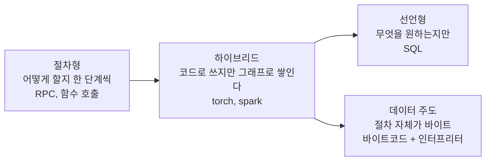

### 4.2 IDL

**인터페이스(어떤 함수가 어떤 타입을 받고 돌려주는지)만 언어 중립적으로 적어 두고, 각 언어의 코드는 생성한다.**

Python 서버와 Go 클라이언트가 대화한다. "이 함수는 이런 것을 받아서 이런 것을 돌려준다"를 어디에, 어떤 언어로 적을까?

서로 다른 언어로 만든 서비스가 대화하려면 "함수 이름, 인자 타입, 반환 타입"을 **공통 언어**로 적어야 한다. 그것이 **IDL(Interface Definition Language)** 이다.

```protobuf
// ── 데이터 약속 (2절의 영역) ──
message HelloRequest {
  string name = 1;
}
message HelloReply {
  string message = 1;
}

// ── 절차 약속 (4절의 영역) ──
service Greeter {
  rpc SayHello (HelloRequest) returns (HelloReply);
}
```

- protobuf의 `service` → gRPC 스텁 생성
- OpenAPI(Swagger) YAML → REST 클라이언트/서버 코드
- Thrift, Cap'n Proto, GraphQL 스키마

IDL은 데이터 형식(2절)과 절차(4절)를 잇는 경첩이다. `message`는 데이터 약속이고, `service`는 절차 약속이다. 그리고 **재사용의 가장 직접적인 형태**이기도 하다. `.proto` 파일 하나에서 Python, Go, Java, TypeScript 코드가 각각 생성된다. 약속을 한 번 적고, 모든 언어가 그것을 재사용한다.

:::info 자주 나오는 질문
- **"OpenAPI는 코드 생성 없이 문서로만 쓰는데요?"** 그래도 IDL이다. 생성은 선택이고, **약속이 본질**이다.
- **"GraphQL은요?"** 스키마는 IDL이고, 쿼리는 4.4의 선언형에 가깝다. 클라이언트가 "무엇을 원하는지"만 적어 보낸다.
:::

**생각할 문제:** IDL은 데이터 형식에 대한 약속일까, 절차에 대한 약속일까? 둘 중 하나만 바뀌면 어떤 일이 생길까?

IDL에 적힌 함수를 실제로 부르면 무슨 일이 일어날까?

### 4.3 절차형: RPC

**원격 호출을 로컬 함수처럼 보이게 한다. 내부에서는 함수 이름과 인자를 직렬화해서 보낸다. 로컬처럼 보이게 만들 때 숨겨지는 것이 지연, 부분 실패, 멱등성이다.**

`await api.add(1, 2)`. 이게 로컬 함수인지 네트워크 호출인지 코드만 보고 알 수 있을까?

```mermaid
sequenceDiagram
  participant App as 호출자
  participant Stub as 스텁 (Proxy)
  participant Net as 전송
  participant Srv as 서버
  App->>Stub: api.add(1, 2)
  Stub->>Net: {"method":"add","args":[1,2],"id":7}
  Net->>Srv: bytes
  Srv->>Srv: add(1, 2) 실행
  Srv-->>Net: {"id":7,"result":3}
  Net-->>Stub: bytes
  Stub-->>App: 3 (Promise 해결)
```

**스텁(stub)** 은 함수처럼 생겼지만, 실제로는 "이름과 인자를 포장해서 보내고 응답을 기다리는" 코드다. 서버 쪽 스켈레톤은 받은 이름으로 실제 함수를 찾아 호출한다.

여기서 중요한 점이 있다. 보내는 것은 **함수 자체가 아니라 함수 이름**이다. 서버에 그 이름의 함수가 이미 있어야 한다. 2.3의 "함수를 넘기는 네 가지 방법" 중 가장 안전한 **이름만 보내기**가 이것이다. 서버는 허용 목록(등록된 메서드)에 있는 것만 실행한다. 식당의 "3번 메뉴 주세요"다.

로컬 호출과 다른 점이 세 가지 있다.

- **지연:** 로컬은 나노초, 원격은 밀리초다. 반복문 안에서 RPC를 부르면 1,000배 이상 느려진다 (← 2장 "배칭과 풀링", N+1).
- **부분 실패:** 요청이 갔는지, 처리됐는지, 응답만 사라졌는지 호출자는 알 수 없다.
- **멱등성:** 그래서 "다시 보내도 되는가"가 설계 문제가 된다. 3.3 시나리오 F와 같은 문제다.

간략화한 RPC를 만들어 보자. `Proxy`로 로컬 함수처럼 부르지만, 실제로 나가는 것은 이름과 인자다. (진짜 RPC는 비동기라 `await`가 붙지만, 여기서는 동기로 흉내 낸다.)

```jsx live noInline showLineNumbers
const sent = [];
const api = new Proxy({}, { get: (_, method) => (...args) => sent.push(JSON.stringify({ method, args })) });

function Test_스텁은_함수_대신_이름과_인자를_보낸다() {
  api.add(1, 2); // 로컬 함수처럼 보인다
  return `실제로 나간 것: ${sent[0]}`;
}

render(Test_스텁은_함수_대신_이름과_인자를_보낸다);
```

```jsx live noInline showLineNumbers
const methods = { add: (a, b) => a + b }; // 허용 목록
const serve = ({ method, args }) => (method in methods ? methods[method](...args) : `거절: ${method} 는 없다`);

function Test_서버는_등록된_이름만_실행한다() {
  return `add → ${serve({ method: "add", args: [1, 2] })} / deleteAll → ${serve({ method: "deleteAll", args: [] })}`;
}

render(Test_서버는_등록된_이름만_실행한다);
```

이제 응답이 돌아오는 길에 사라졌다고 하자. 지금 `charge`는 실행됐을까, 안 됐을까?

```jsx live noInline showLineNumbers
const serverLog = [];
const serve = (req) => { serverLog.push(`${req.method} 실행`); return "ok"; };
const call = (req) => { serve(req); throw new Error("timeout"); }; // 서버는 처리했지만 응답이 사라졌다

function Test_응답이_사라지면_실행됐는지_알_수_없다() {
  try {
    call({ method: "charge", args: [100] });
  } catch (e) {
    return `호출자가 본 것: ${e.message} / 서버 로그: ${serverLog}`;
  }
}

render(Test_응답이_사라지면_실행됐는지_알_수_없다);
```

```jsx live noInline showLineNumbers
let balance = 1000;
let attempt = 0;
const charge = (won) => {
  balance -= won;
  if (++attempt === 1) throw new Error("timeout"); // 첫 응답만 유실됐다
  return "ok";
};

function Test_멱등하지_않은_호출을_재시도하면_두_번_결제된다() {
  try { charge(100); } catch (e) { charge(100); } // 타임아웃이면 한 번 더
  return `호출자: 성공 / 잔액: ${balance} (100원짜리를 두 번 냈다)`;
}

render(Test_멱등하지_않은_호출을_재시도하면_두_번_결제된다);
```

호출자는 timeout만 보지만 서버는 이미 실행했다. **모른다**가 답이다. 그래서 무심코 재시도하면 `charge`가 두 번 실행된다. `add`는 다시 보내도 괜찮지만 `charge`는 아니다. 그리고 등록되지 않은 `deleteAll`을 서버가 거절할 수 있는 것은 **이름만 보내기** 때문이다.

:::info 자주 나오는 질문 — "gRPC와 REST는 뭐가 다른가요?"
둘 다 넓게 보면 원격 호출이다. gRPC는 IDL(4.2)에서 스텁을 생성하고 protobuf로 직렬화한다. REST는 "자원(URL) + 동사(HTTP 메서드)"라는 관례다. 어느 쪽이든 지연·부분 실패·멱등성은 똑같이 숨어 있다. REST가 `PUT`·`DELETE`를 멱등하게, `POST`를 멱등하지 않게 정의해 둔 것도 그 때문이다.
:::

**생각할 문제:** 응답이 오지 않았을 때 다시 보내도 될까? `add`라면? `charge(100원)`이라면?

RPC는 "이 함수를 실행해"라고 **어떻게**를 다 정해서 보냈다. 어떻게는 정하지 않고 **무엇을 원하는지만** 보낼 수도 있을까?

### 4.4 선언형: SQL

**"무엇을 원하는지"만 적고 "어떻게 할지"는 엔진이 정한다. 그래서 엔진이 실행 순서를 바꿀 수 있다.**

`SELECT` 문에는 for 루프가 없다. 그런데 결과는 나온다. 누가 루프를 돌렸을까?

`SELECT name FROM users WHERE age > 20 ORDER BY name`은 순서를 말하지 않는다. 인덱스를 탈지, 정렬을 먼저 할지는 엔진(**옵티마이저**)이 정한다. 같은 것을 절차형으로 쓰면 "전체를 돌면서 → age 확인 → 모아서 → 정렬"이라고 순서를 **내가** 정한다. 데이터가 바뀌어도 그 순서는 안 바뀐다.

- **선언형의 이득:** 데이터 분포가 바뀌면 엔진이 다른 계획을 고른다. 통계를 보고 조인 순서를 바꾸고, 인덱스가 생기면 알아서 쓴다.
- **선언형의 비용:** 왜 느린지 알기 어렵다. `EXPLAIN`으로 엔진이 고른 계획을 봐야 한다. 가끔 엔진이 틀린 선택을 하고, 그때는 힌트로 "어떻게"를 다시 알려 준다.

절차형으로 쓰면 순서를 내가 정한다.

```js
// 절차형: 데이터가 바뀌어도 이 순서 그대로 돈다
const result = [];
for (const u of users) if (u.age > 20) result.push(u.name);
result.sort();
```

선언형은 무엇만 적는다. 간략화한 옵티마이저가 통계를 보고 계획을 고른다. 질의는 그대로이고, 데이터 분포만 다르다.

```jsx live noInline showLineNumbers
// SELECT name FROM users WHERE age > 20 ORDER BY name — 질의는 그대로, 통계만 다르다
const plan = (passRatio) =>
  passRatio < 0.3 ? "IndexScan(age > 20) → Sort(name)" : "SeqScan(users) → Filter(age > 20) → Sort(name)";

function Test_조건을_통과하는_행이_적으면_인덱스를_탄다() {
  return `통과하는 행 10% → ${plan(0.1)}`;
}

render(Test_조건을_통과하는_행이_적으면_인덱스를_탄다);
```

```jsx live noInline showLineNumbers
// SELECT name FROM users WHERE age > 20 ORDER BY name — 질의는 그대로, 통계만 다르다
const plan = (passRatio) =>
  passRatio < 0.3 ? "IndexScan(age > 20) → Sort(name)" : "SeqScan(users) → Filter(age > 20) → Sort(name)";

function Test_조건을_통과하는_행이_많으면_통째로_읽는다() {
  return `통과하는 행 90% → ${plan(0.9)}`;
}

render(Test_조건을_통과하는_행이_많으면_통째로_읽는다);
```

2.3의 관점에서 보면 SQL은 **"제한된 표현(DSL)"** 이다. 표현력을 일부러 좁혔다. 임의의 루프도, 임의의 함수 호출도 없다. 그래서 엔진이 **최적화할 수 있고**, 받은 질의를 **안전하게 실행할 수 있다.** 표현력을 좁혀서 얻은 것이 이 두 가지다.

:::info 자주 나오는 질문
- **"ORM도 선언형인가요?"** 쿼리 빌더 부분은 그렇다. 하지만 루프 안에서 `.get()`을 부르는 순간 절차형으로 돌아가고, N+1이 생긴다(2장).
- **"SQL 인젝션은요?"** 2.3의 `eval`과 같은 계열이다. **데이터가 코드로 해석된** 것이다. 문자열을 이어 붙여 질의를 만들면 사용자 입력이 질의의 일부(코드)가 된다. 파라미터 바인딩은 "이 자리는 값이다"라고 못 박는 장치로, `JSON.parse`가 하는 역할과 같다.
:::

**생각할 문제:** 선언형이 절차형보다 불리한 경우는 언제일까?

코드처럼 쓰는데 사실은 선언형처럼 나중에 실행되는 것도 있다. 매일 쓰는 것일 수도 있다.

### 4.5 하이브리드형: 그래프 (torch, spark)

**절차형처럼 코드를 쓰지만, 실제로는 계산 그래프를 데이터로 쌓아 두고 나중에 실행하거나 최적화한다. 그래프가 데이터이기 때문에 미분하고, 나누고, 다른 머신으로 보낼 수 있다.**

`y = x * w + b`를 쳤다. 곱셈이 지금 실행됐을까? torch에서는 "예, 그리고 아니오"다.

```mermaid
flowchart LR
  R["read"] --> F["filter"] --> M["map"] --> G["groupBy"] --> Cn["count"]
  Cn -. "action 호출 시점에<br/>그래프 전체를 최적화해서 실행" .-> X["결과"]
```

- **torch:** `y = x * w + b`라고 쓰면 곱셈과 덧셈은 그 자리에서 계산된다(eager). 그런데 동시에 "y는 x와 w의 곱에 b를 더한 것"이라는 **그래프가 뒤에 남는다.** `y.backward()`는 이 그래프를 거꾸로 따라가며 기울기를 계산한다. 그래프가 데이터라서 가능하다. `torch.compile`은 한 걸음 더 가서, 그래프를 먼저 모은 뒤 연산을 합치고(fusion) 커널을 생성한다.
- **spark:** `df.filter(...).map(...).groupBy(...)`는 **아무것도 실행하지 않는다**(lazy). transformation을 쌓아 두었다가 `.count()` 같은 action이 호출될 때 DAG 전체를 보고 최적화한다. 그래서 filter를 read 직후로 당기거나(predicate pushdown), 필요 없는 컬럼을 아예 읽지 않는다. 4.4의 옵티마이저가 하던 일을 코드 위에서 한다.

두 경우 모두 **"코드처럼 쓰지만 데이터로 쌓인다"** 는 점이 같다. 그러면 2절에서 데이터를 다뤘던 방식이 절차에도 그대로 적용된다. 그래프를 직렬화해서 다른 머신으로 보낼 수 있고(spark executor), 저장할 수 있고(ONNX, TorchScript), 분석할 수 있다.

Spark에서 자주 보는 `Task not serializable` 에러가 바로 이 지점에서 생긴다. 그래프 노드 안의 람다가 바깥 객체를 잡고 있으면, 그래프를 보낼 때 그 객체도 딸려 가야 한다(2.3-B의 "바이트코드 + 환경"). 그 객체가 직렬화될 수 없으면 실행하기도 전에 실패한다.

micrograd 스타일로 흉내 내 보자. 연산할 때마다 결과와 함께 "어디서 왔는지"가 남는다.

```jsx live noInline showLineNumbers
const x = { label: "x", data: 2 }, w = { label: "w", data: -3 }, b = { label: "b", data: 10 };
const xw = { label: "x·w", data: x.data * w.data, parents: [x, w] }; // 계산은 지금 (eager)
const y = { label: "y", data: xw.data + b.data, parents: [xw, b] };  // ...그리고 출처가 남는다
const show = (v) => (v.parents ? `${v.label}(${v.parents.map(show).join(", ")})` : v.label);

function Test_연산하면_값과_함께_그래프가_남는다() {
  return `y = ${y.data}, 그래프: ${show(y)}`;
}

render(Test_연산하면_값과_함께_그래프가_남는다);
```

```jsx live noInline showLineNumbers
const x = { label: "x", data: 2 }, w = { label: "w", data: -3 }, b = { label: "b", data: 10 };
const xw = { label: "x·w", data: x.data * w.data, parents: [x, w] }; // 계산은 지금 (eager)
const y = { label: "y", data: xw.data + b.data, parents: [xw, b] };  // ...그리고 출처가 남는다

function Test_backward는_그래프를_거꾸로_따라간다() {
  y.grad = 1;                                           // y 에서 출발해서
  xw.grad = y.grad; b.grad = y.grad;                    // 덧셈은 기울기를 그대로 넘기고
  x.grad = w.data * xw.grad; w.grad = x.data * xw.grad; // 곱셈은 상대편 값을 곱해 넘긴다
  return `x.grad=${x.grad}, w.grad=${w.grad}, b.grad=${b.grad}`;
}

render(Test_backward는_그래프를_거꾸로_따라간다);
```

`grad`는 "이 값을 조금 바꾸면 y가 얼마나 바뀌나"다. `w`의 grad가 `x`의 값(2)과 같은 이유를 생각해 보자. 여기서는 손으로 적었지만, 진짜 autograd는 `parents`를 따라가며 이 줄들을 자동으로 실행한다. 그래프가 없었다면 따라갈 길이 없다.

:::info 자주 나오는 질문
- **"그럼 eager 모드는 왜 있나요?"** 디버깅 때문이다. `print`가 그 자리에서 찍히고 중간값을 볼 수 있다. spark의 `filter` 안 `print`가 안 찍히는 문제(아래)가 바로 lazy의 대가다.
- **"`torch.compile`은 왜 느릴 때가 있나요?"** 그래프를 모으고 컴파일하는 비용이 먼저 든다. 같은 그래프를 여러 번 돌려야 이득이다.
:::

**생각할 문제**

- 그래프를 데이터로 들고 있으면 무엇이 가능해질까?

- spark에서 `.filter()` 안에 `print`를 넣었는데 아무것도 안 찍힌다. 왜일까?

그래프를 데이터로 들고 있다가 **실행기**가 돌린다. 그 실행기를 끝까지 단순하게 만들면 무엇이 될까? 명령어 몇 개와 루프 하나다.

### 4.6 데이터 주도형 = 인터프리터

**동작을 코드의 분기로 쓰는 대신 데이터(표)로 적고, 단순한 루프 하나가 그 표를 읽어 실행한다. 그 표가 명령어 목록이면 인터프리터가 된다. 2.1의 "프로그램도 데이터"로 돌아오고, 2.3의 toy pickle이 사실 이것이었다.**

Dave Thomas는 *Simplicity*(2025, 한국어판 『미니멀리즘 프로그래머』)의 "Data Driven" 장에서, 코드가 데이터를 처리하기만 하는 대신 **데이터가 코드의 동작을 이끌게** 하라고 권한다. 데이터는 코드보다 이해하기 쉽고 바꾸기 쉽기 때문이다. 비슷한 분기가 줄줄이 반복되는 코드는 **무엇이 다른지만 적은 표**와 **그 표를 읽는 함수 하나**로 접을 수 있다. 그는 이것을, 쉽게 쓸 수 있고 효과도 큰데 의외로 잘 쓰이지 않는 기법으로 꼽는다.

계산기 하나를 만든다고 해 보자. 흔한 모양은 이렇다. 명령어마다 `if`가 하나씩 늘어난다.

```js
// 명령어가 늘 때마다 루프 안의 if 가 늘어난다
for (let pc = 0; code[pc] !== "HALT"; pc++) {
  const op = code[pc];
  if (op === "PUSH") stack.push(code[++pc]);
  if (op === "ADD") stack.push(stack.pop() + stack.pop());
  if (op === "MUL") stack.push(stack.pop() * stack.pop());
  // if (op === "SUB") ...
}
```

sensible한가, smelly한가? 분기 하나하나는 단순하다. 하지만 "이 기계가 무엇을 할 수 있는가"가 루프 안의 분기 사이에 **흩어져 있다.** 그걸 알려면 루프를 끝까지 읽어야 하고, 명령어를 하나 더하려면 루프를 고쳐야 한다. 데이터 주도로 바꾸면 명령어 집합은 `Map` 한 장이 되고, 루프는 그 표를 찾아보기만 한다.

```mermaid
flowchart TD
  S["pc = 0"] --> F["op = code[pc]"]
  F --> H{"HALT?"}
  H -- "예" --> E["끝"]
  H -- "아니오" --> L{"명령어 표에<br/>op가 있나?"}
  L -- "없다" --> X["거절"]
  L -- "있다" --> R["표에 적힌 동작 실행<br/>PUSH · ADD · MUL"]
  R --> I["pc 증가"] --> F
```

인터프리터는 "데이터를 읽고 → 표에서 할 일을 찾고 → 다음 데이터를 읽는" 루프다. 읽는 데이터가 명령어면 그것이 **VM(가상 머신)** 이다.

CPython의 `.pyc`, JVM의 `.class`, WebAssembly, 그리고 2.1의 ELF 안 기계어까지, 모두 **루프가 읽어 실행하는 바이트**다. CPU도 결국 기계어 바이트를 읽어 실행하는 하드웨어 인터프리터다.

직접 만들어 보자. 명령어 집합은 표 하나, 실행기는 루프 하나다.

```jsx live noInline showLineNumbers
// 명령어 집합 = 이름 → 동작. 이 기계가 할 수 있는 일은 이 표에 다 있다
const OPS = new Map([
  ["PUSH", { arg: true, run: (stack, n) => stack.push(n) }],
  ["ADD", { run: (stack) => stack.push(stack.pop() + stack.pop()) }],
  ["MUL", { run: (stack) => stack.push(stack.pop() * stack.pop()) }],
]);

// 루프는 표를 찾아보기만 한다. 명령어가 늘어도 이 함수는 그대로다
function execute(code) {
  const stack = [];
  for (let pc = 0; code[pc] !== "HALT"; pc++) {
    const op = OPS.get(code[pc]);
    if (!op) throw new Error(`표에 없는 명령어: ${code[pc]}`);
    op.run(stack, op.arg ? code[++pc] : undefined);
  }
  return stack.pop();
}

function Test_루프는_명령어_표를_읽어_계산한다() {
  const code = ["PUSH", 2, "PUSH", 3, "ADD", "PUSH", 4, "MUL", "HALT"]; // (2 + 3) × 4
  return `결과: ${execute(code)}`;
}

render(Test_루프는_명령어_표를_읽어_계산한다);
```

명령어를 하나 추가하려면? 루프가 아니라 **표에 한 줄**을 더한다.

```jsx live noInline showLineNumbers
// 명령어 집합 = 이름 → 동작. 이 기계가 할 수 있는 일은 이 표에 다 있다
const OPS = new Map([
  ["PUSH", { arg: true, run: (stack, n) => stack.push(n) }],
  ["ADD", { run: (stack) => stack.push(stack.pop() + stack.pop()) }],
  ["MUL", { run: (stack) => stack.push(stack.pop() * stack.pop()) }],
]);

// 루프는 표를 찾아보기만 한다. 명령어가 늘어도 이 함수는 그대로다
function execute(code) {
  const stack = [];
  for (let pc = 0; code[pc] !== "HALT"; pc++) {
    const op = OPS.get(code[pc]);
    if (!op) throw new Error(`표에 없는 명령어: ${code[pc]}`);
    op.run(stack, op.arg ? code[++pc] : undefined);
  }
  return stack.pop();
}

function Test_명령어를_추가해도_루프는_고치지_않는다() {
  OPS.set("SUB", { run: (stack) => { const b = stack.pop(); stack.push(stack.pop() - b); } }); // 표에 한 줄
  return `결과: ${execute(["PUSH", 10, "PUSH", 3, "SUB", "HALT"])} — execute 는 한 줄도 안 바꿨다`;
}

render(Test_명령어를_추가해도_루프는_고치지_않는다);
```

표는 이 기계가 할 수 있는 일의 목록이면서, 동시에 **할 수 없는 일의 경계**이기도 하다.

```jsx live noInline showLineNumbers
// 명령어 집합 = 이름 → 동작. 이 기계가 할 수 있는 일은 이 표에 다 있다
const OPS = new Map([
  ["PUSH", { arg: true, run: (stack, n) => stack.push(n) }],
  ["ADD", { run: (stack) => stack.push(stack.pop() + stack.pop()) }],
  ["MUL", { run: (stack) => stack.push(stack.pop() * stack.pop()) }],
]);

// 루프는 표를 찾아보기만 한다. 명령어가 늘어도 이 함수는 그대로다
function execute(code) {
  const stack = [];
  for (let pc = 0; code[pc] !== "HALT"; pc++) {
    const op = OPS.get(code[pc]);
    if (!op) throw new Error(`표에 없는 명령어: ${code[pc]}`);
    op.run(stack, op.arg ? code[++pc] : undefined);
  }
  return stack.pop();
}

function Test_표에_없는_명령어는_실행되지_않는다() {
  try {
    return execute(["PUSH", "red", "CALL", "changeBackground", "HALT"]); // 2.3 의 조작한 payload
  } catch (e) {
    return `${e.message} — 이 기계는 할 수 없는 일이다`;
  }
}

render(Test_표에_없는_명령어는_실행되지_않는다);
```

그럼 2.3의 toy pickle이 가진 명령어, "이름으로 함수를 찾아 호출하라"를 표에 한 줄 더하면?

```jsx live noInline showLineNumbers
const page = { background: "white" };
const GLOBALS = { changeBackground: (color) => { page.background = color; } };

// 명령어 집합 = 이름 → 동작. 이 기계가 할 수 있는 일은 이 표에 다 있다
const OPS = new Map([
  ["PUSH", { arg: true, run: (stack, n) => stack.push(n) }],
  ["ADD", { run: (stack) => stack.push(stack.pop() + stack.pop()) }],
  ["MUL", { run: (stack) => stack.push(stack.pop() * stack.pop()) }],
]);

// 루프는 표를 찾아보기만 한다. 명령어가 늘어도 이 함수는 그대로다
function execute(code) {
  const stack = [];
  for (let pc = 0; code[pc] !== "HALT"; pc++) {
    const op = OPS.get(code[pc]);
    if (!op) throw new Error(`표에 없는 명령어: ${code[pc]}`);
    op.run(stack, op.arg ? code[++pc] : undefined);
  }
  return stack.pop();
}

function Test_CALL_한_줄을_표에_더하면_pickle이_된다() {
  OPS.set("CALL", { arg: true, run: (stack, name) => GLOBALS[name](stack.pop()) }); // 이름으로 찾아 호출
  execute(["PUSH", "red", "CALL", "changeBackground", "HALT"]);
  return `배경색: ${page.background} — 계산기가 pickle 이 됐다`;
}

render(Test_CALL_한_줄을_표에_더하면_pickle이_된다);
```

2.3의 toy pickle과 나란히 놓아 보자.

| | 스택 VM | toy pickle / 진짜 pickle |
|---|---|---|
| 값을 쌓는다 | `PUSH` | `PUSH` / `SHORT_BINUNICODE` 등 |
| 계산한다 | `ADD`, `MUL` | (객체를 조립한다) |
| **이름으로 함수를 찾는다** | 없음 | `CALL` / `STACK_GLOBAL` |
| **찾은 함수를 호출한다** | 없음 | `CALL` / `REDUCE`, `NEWOBJ` |
| 데이터를 열었을 때 할 수 있는 일 | 계산 결과를 만든다 | 보낸 사람이 고른 함수를 실행한다 |

**표 한 줄(진짜 pickle에서는 찾기와 호출, 두 줄) 차이다.** 명령어 집합이 "값을 쌓는 것"에서 "함수를 부르는 것"으로 넓어지는 순간, 데이터 형식은 프로그램이 되고 RCE의 뿌리가 생긴다. pickle은 처음부터 스택 VM이었다. 2.1에서 시작한 "프로그램도 데이터다"가 여기서 한 바퀴를 돈다. 그리고 2.3의 결론이 정확한 말로 다시 나온다.

> **어떤 명령어를 허용할지가 곧 형식의 안전성이다.**

데이터 주도로 짜면 이 문장이 코드에서도 그대로 보인다. 허용되는 명령어는 `OPS`라는 표 한 장이다. 한 줄을 더하면 할 수 있는 일이 늘고, 빼면 막힌다. 무엇을 허용했는지 확인하려고 루프를 읽을 필요가 없다. 돌아보면 2.3의 허용 목록 Unpickler, 3.2의 디코더 등록, 4.3의 등록된 메서드만 실행하는 RPC 서버가 모두 같은 모양이었다. **이름 → 동작의 표**와, 그 표를 읽는 단순한 코드.

같은 생각은 업무 로직에도 그대로 쓰인다. Thomas는 같은 장에서 표로 다루는 방식이 **상태 머신**으로 자연스럽게 이어진다고 말한다. 주문 상태를 `if`와 플래그로 뒤섞는 대신 전이표로 적어 보자.

```jsx live noInline showLineNumbers
// 상태 전이표: 지금 상태 → (이벤트 → 다음 상태). 규칙은 전부 여기 있다
const TRANSITIONS = new Map([
  ["주문됨", new Map([["결제", "결제됨"], ["취소", "취소됨"]])],
  ["결제됨", new Map([["배송", "배송중"], ["취소", "환불됨"]])],
  ["배송중", new Map([["도착", "완료"]])],
]);

const next = (state, event) => TRANSITIONS.get(state)?.get(event) ?? `${state}에서는 ${event} 불가`;

function Test_전이표에_없는_전이는_일어나지_않는다() {
  return [next("주문됨", "결제"), next("결제됨", "배송"), next("배송중", "취소")].join(" → ");
}

render(Test_전이표에_없는_전이는_일어나지_않는다);
```

"배송 중에도 취소할 수 있게 해 주세요"라는 요청이 오면, 고칠 곳은 표의 한 칸이다. 그리고 지금 어떤 전이가 허용되는지는 표만 보면 알 수 있다.

설정 파일도 마찬가지다. 설정이 표로 남아 있는 동안은 데이터다. 그런데 그 표가 조건과 반복을 갖기 시작하면 이야기가 달라진다.

:::info 자주 나오는 질문 — "JIT은요?"
인터프리터가 자주 도는 바이트코드를 기계어로 바꿔 두는 것이다. 실행 속도가 바뀔 뿐, 바이트코드가 데이터라는 사실은 그대로다.
:::

**생각할 문제:** 설정 파일이 점점 조건문과 반복을 갖게 되면, 그것은 언제부터 프로그래밍 언어일까? 그 시점에 무엇을 조심해야 할까?

<details>
<summary>생각해 볼 방향 — 펼쳐보기</summary>

조건과 반복이 들어오는 순간, 그 파일을 읽는 프로그램은 "파서"에서 "인터프리터"가 된다. 그때부터 물어야 할 것은 2.3의 결정 트리와 같다. **누가 그 파일을 쓸 수 있는가?** 그리고 **그 언어가 무엇까지 할 수 있는가?** 파일을 바깥 사람이 쓸 수 있다면, 표현력(특히 "함수 호출", "파일·네트워크 접근")을 일부러 좁힌 DSL로 막아 둬야 한다. 처음부터 범용 언어를 설정 파일로 쓸 거라면, 그 파일은 이제 **코드**로 리뷰하고 배포해야 한다.

</details>

:::tip 절차 표현 미학 체크리스트

**약속이 어디에 적혀 있는가?**

- 인터페이스(함수 이름, 인자·반환 타입)가 IDL처럼 언어 중립적인 곳에 한 번만 적혀 있는가? 언어마다 손으로 따로 적고 있지 않은가?
- 허용되는 동작(메서드, 명령어, 상태 전이)이 표 한 장에 모여 있는가, 분기 사이에 흩어져 있는가?

**표현력이 필요한 만큼인가?**

- 이름만 보내도 되는 일에 코드를 보내고 있지 않은가? (이름 → DSL → 바이트코드 → 함수 통째로)
- 받는 쪽 명령어 표에 "이름으로 함수를 찾아 호출하라"는 줄이 있는가?
- 설정 파일이 조건과 반복을 갖기 시작했다면, 그 파일을 코드로 다루고 있는가?

**직렬화/역직렬화를 태우는가?**

- 원격 호출이 로컬처럼 보이면서 지연·부분 실패·멱등성을 숨기고 있지 않은가? 다시 보내도 되는 호출인가?
- 그래프나 람다를 보낼 때 클로저가 무엇을 끌고 가는가?

:::

처음에 "이 바이트는 뭘까?"로 시작했다. 이제 답할 수 있다. 정리하고 끝내자.

---

## 5. 마치기

이 장을 관통하는 한 문장:

> **표현할 수 있는 것이 많을수록 편리하고, 그만큼 위험하다.**

| 절 | 한 줄 요약 |
|---|---|
| 1 이 바이트는 뭘까 | 바이트는 끊어 읽는 약속이 있어야 의미가 된다 |
| 2.1 ELF | 실행 파일도 헤더 붙은 데이터다 |
| 2.2 직렬화 | 주소 공간을 벗어나면 bytes가 되고, 그 비용이 프로세스 분리의 약점이다 |
| 2.3 직렬화 심화 | 비용은 복사를 피해서 줄이고, 함수까지 보내려 들면 받는 쪽이 코드를 실행한다 |
| 2.4 유니코드 | 21비트면 되지만 UTF-8을 쓰고, "문자 하나"는 층마다 다르다 |
| 2.5 base64 | 6비트씩 끊어 글자로, 33% 더 크다 |
| 2.6 필요한 정보 vs redundancy | 압축하기 · 빨리 읽기 · 스키마 유연성은 트레이드오프 관계다 |
| 2.7 self-contained / BSON | 해석법을 들고 다니면 독립적이지만 크다. BSON은 그 값을 치른 형식이다 |
| 2.8 UUID / Snowflake | 랜덤에 기대거나 공간을 미리 나누거나 |
| 2.9 저장공간 | 레코드 × 개수 × 기간 × 오버헤드, 자릿수를 맞춘다 |
| 3.2 덧붙이기 | 경계를 건널 때마다 메타정보가 붙어 헤더가 되고, 헤더가 붙는 곳이 계층의 경계다 |
| 3.3 nonce | 추측 불가 · 사용자 묶기 · 만료 · 한 번만 · 재시도 구분. 상태를 어디 둘지가 갈림길 |
| 4.2 IDL | 인터페이스만 공통 언어로 적고 코드는 생성 |
| 4.3 RPC | 이름과 인자를 보낸다, 지연 · 부분 실패 · 멱등성이 숨는다 |
| 4.4 SQL | 무엇만 말하면 엔진이 어떻게를 정한다 |
| 4.5 그래프 | 코드처럼 쓰지만 데이터로 쌓인다 |
| 4.6 인터프리터 | 동작을 표로 적고 루프가 읽어 실행한다. 그 표가 곧 명령어 집합이고, 안전성을 정한다 |

오늘 본 것은 모두 **"약속을 어디에 적어 두는가"** 의 변주다. 헤더에, 스키마 파일에, IDL에, 바이트 자신에. 그리고 잘 적어 둔 약속 하나는 수없이 **재사용된다**. 하나의 형식을 수많은 프로그램이 읽고, 하나의 봉투 규칙 위에서 수많은 디코더가 돌고, 하나의 `.proto`에서 여러 언어의 코드가 나온다.

:::tip 표현 미감 체크리스트 — 세 갈래 총정리

**약속이 어디에 적혀 있는가?**

- 바이트 자신이 자기 형식을 알려 주는가(magic, version, type)? 헤더에 받는 쪽이 알아야 할 것이 다 있는가?
- 해석법(스키마)을 들고 다니는가, 바깥에 두는가? 데이터의 수명에 맞는가?
- 그 약속(IDL, `.proto`, 필드 번호)이 바뀌면 누가 조용히 틀리고 누가 시끄럽게 실패하는가?

**표현력이 필요한 만큼인가?**

- 역직렬화기·검증기·설정 파일이 "값"만 만드는가, "함수"를 부를 수 있는가?
- 해석 방법(`alg`, 호출할 함수 이름)을 데이터가 고르게 두지 않았는가?
- 표현력을 일부러 좁힌 DSL(SQL, 이름만 보내는 RPC, 허용 목록)로 바꿀 수 있는가?

**직렬화/역직렬화를 태우는가?**

- 피할 수 있는가? 경계마다 복사하고 있지 않은가?
- 어떤 형식을 쓰는가? 압축하기 / 빨리 읽기 / 스키마 유연성 중 무엇을 얻고 무엇을 내줬는가? 헤더가 payload보다 크지 않은가?
- 원격 호출이 로컬처럼 보이면서 지연·부분 실패·멱등성을 숨기고 있지 않은가?

:::

어떤 형식을 고를지 정할 때, 먼저 이렇게 물어 보자. **"이 약속은 어디에 있고, 누가 바꿀 수 있고, 얼마나 많은 것을 표현할 수 있나?"**

### 5.1 AI가 코드를 다 짜는 시대에

2장에서 엔지니어에게 남는 일이 둘이라고 했다. **좋은 설계를 고르는 눈**과 **근거로 리뷰하는 눈**. 형식과 표현에서도 똑같다.

AI는 묻지 않으면 가장 짧은 코드를 가져온다. 그리고 가장 짧은 코드는 대개 **표현력이 가장 큰** 도구를 쓴다.

- 모델을 불러오라고 하면 `pickle.load(open(path, "rb"))`나 `torch.load(path)`를 쓴다. 그 파일이 어디서 왔는지는 묻지 않는다.
- 설정을 읽으라고 하면 `yaml.load`를 쓰고, 계산식을 받으라고 하면 `eval`을 쓴다.
- 캐시에 넣으라고 하면 `JSON.stringify`로 `Map`과 `Date`를 조용히 망가뜨린다.
- ID 컬럼을 만들라고 하면 `VARCHAR(36)`에 UUID v4를 넣고, 인덱스가 왜 느려지는지는 말하지 않는다.
- 병렬화하라고 하면 `multiprocessing.Pool`에 큰 DataFrame을 그대로 넘긴다.

코드는 전부 **돌아간다**. 문제는 "돌아가는가"가 아니라 **"이 형식이 무엇을 표현할 수 있고, 직렬화/역직렬화를 태울 때 무엇을 치르는가"** 이고, 그건 AI에게 시키기 전에 사람이 정하는 의도 결정이다. 그리고 AI가 가져온 코드를 받아 들고 "이 역직렬화기는 함수를 부를 수 있다", "이 헤더에는 version이 없다", "이 재시도는 멱등하지 않다"를 짚어 내는 것이 근거 있는 리뷰다.

> **표현할 수 있는 것이 많을수록 편리하고, 그만큼 위험하다. 그 "많이"를 얼마나 허락할지는 사람이 정한다.**

### 더 볼 자료

- ELF: System V ABI, `man 5 elf`
- UTF-8: [RFC 3629](https://www.rfc-editor.org/rfc/rfc3629)
- base64: [RFC 4648](https://www.rfc-editor.org/rfc/rfc4648)
- Gorilla: Pelkonen et al., *Gorilla: A Fast, Scalable, In-Memory Time Series Database* (VLDB 2015)
- [Protocol Buffers — Encoding](https://protobuf.dev/programming-guides/encoding/)
- [BSON 스펙](https://bsonspec.org/spec.html)
- UUID: [RFC 9562](https://www.rfc-editor.org/rfc/rfc9562)
- Twitter, *Announcing Snowflake* (2010)
- JWT: [RFC 7519](https://www.rfc-editor.org/rfc/rfc7519)
- [Python `pickle` 문서](https://docs.python.org/3/library/pickle.html)의 보안 경고
- [safetensors](https://github.com/huggingface/safetensors), PyTorch `torch.load(weights_only=True)`
- [micrograd](https://github.com/karpathy/micrograd)
- Dave Thomas, *Simplicity: Sustainable, Humane, and Effective Software Development* (Pragmatic Bookshelf, 2025; 한국어판 『미니멀리즘 프로그래머』), Chapter 7 "Data Driven"
